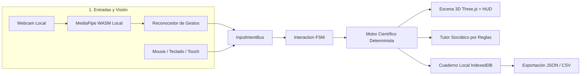

# SymbioLab 2.0 — Laboratorio Científico Inmersivo y Gestual

[](docs/architecture.md)
[](docs/architecture.md)
[](docs/architecture.md)
[](docs/architecture.md)

> **Lema:** *«Tus manos son los instrumentos. Tu curiosidad es el laboratorio».*  
> **Iniciativa:** Hack4Edu 2026 (Reto 17 — Laboratorio donde no existe; Reto 02 — Offline; Reto 04 — Tutor socrático).  
> **Equipo / Organización:** Takumi-Soft.

---

## 🔬 ¿Qué es SymbioLab?

**SymbioLab** convierte una computadora, laptop o tablet estándar con webcam en un laboratorio científico tridimensional e inmersivo en primera persona. 

Los estudiantes manipulan instrumentos de laboratorio directamente con sus manos mediante visión artificial local o mediante controles tradicionales equivalentes (mouse, teclado y táctil), explorando fenómenos gobernados por modelos científicos deterministas, contrastando hipótesis con un tutor socrático y registrando sus hallazgos en un cuaderno offline.

---

## 🏛️ Arquitectura del Sistema

El sistema implementa una estricta separación de responsabilidades y desacoplamiento de capas:



1. **Captura y Visión Efímera:** MediaPipe Hand Landmarker operando con binarios WASM locales. Cero persistencia o transmisión de imágenes de cámara.
2. **Bus de Intenciones (`InputIntentBus`):** Normaliza gestos y controles tradicionales en acciones de dominio (`select`, `grab`, `move`, `pour`, `release`).
3. **Escena 3D Observadora (`Three.js WebGL2`):** Representación visual subjetiva en primera persona que no altera cálculos científicos.
4. **Motor Científico Determinado (`ScienceEngine`):** Modelo analítico de neutralización ácido-base a 25 °C (`strong-acid-base-25C-v1`), estabilizado contra cancelación catastrófica.
5. **Tutoría Socrática y Cuaderno:** Diagnósticos pedagógicos por reglas y almacenamiento en `IndexedDB` con exportación universal (JSON/CSV).

Para más detalles, consulta el documento maestro de arquitectura en [`docs/architecture.md`](docs/architecture.md).

---

## 📂 Estructura del Repositorio

```text
Takumi-Soft/
├── .agents/                      # Configuración de agentes de IA y MCP local
│   ├── mcp_config.json
│   └── skills/                   # Habilidades del agente (Three.js, UI/UX, SDD)
├── docs/                         # Documentación de arquitectura y decisiones
│   └── architecture.md           # Especificación formal de arquitectura v0.2.0
├── static/                       # Recursos estáticos locales (Zero-CDN)
│   ├── assets/models/3d/         # Modelos 3D glTF (matraces, vasos, reactivos)
│   └── models/mediapipe/wasm/    # Binarios WASM locales y modelo Hand Landmarker
├── src/
│   ├── routes/                   # Vistas principales de la aplicación (Svelte 5)
│   └── lib/
│       ├── core/contracts/       # Tipos TypeScript y contratos de datos
│       ├── input/                # Adaptadores de cámara, MediaPipe y bus de intención
│       ├── lab3d/                # Escena Three.js WebGL2 y cámara subjetiva
│       ├── interaction/          # FSM de manipulación y vertido de reactivos
│       ├── science/chemistry/    # Solver analítico de pH y bandas de indicador
│       ├── education/            # Tutor socrático y método científico
│       ├── storage/              # Repositorio IndexedDB y exportación
│       └── offline/              # Auditoría y verificación de estado PWA
├── tests/                        # Suite de pruebas automatizadas
│   ├── science/                  # Pruebas de equilibrio químico y estabilidad numérica
│   ├── input/                    # Pruebas de histéresis y reconocimiento gestual
│   ├── interaction/              # Pruebas de la FSM de objetos
│   └── storage/                  # Pruebas de persistencia y exportación
├── requirements.txt              # Entorno de validación científica en Python
└── SymbioLab_SDD_Consolidado_v0.2.0.md # Especificación SDD consolidada
```

---

## 🚀 Puesta en Marcha

### 1. Entorno de Validación Científica (Python 3.12+)

Se utiliza un entorno virtual de Python para la verificación analítica independiente de los modelos de equilibrio químico, generación de fixtures y comprobaciones estáticas:

```bash
# 1. Crear el entorno virtual
python3 -m venv .venv

# 2. Activar el entorno virtual
source .venv/bin/activate

# 3. Instalar dependencias
pip install -r requirements.txt

# 4. Ejecutar pruebas unitarias de modelos científicos
pytest tests/
```

### 2. Entorno Frontend (Svelte 5 + Three.js)

```bash
# Instalar dependencias de Node.js
npm install

# Iniciar servidor de desarrollo local
npm run dev

# Ejecutar suite de pruebas de TypeScript / Vitest
npm test
```

---

## 🔒 Privacidad y Ética Científica

- **Cero Retención Biométrica:** La cámara web solo se activa bajo consentimiento explícito del estudiante. Ningún frame ni dato facial/manual se almacena en disco o se envía por internet.
- **Funcionamiento 100% Desconectado:** Diseñado para escuelas rurales y aulas sin conectividad. Todo el software, modelos 3D y modelos de IA corren en el dispositivo local.
- **Honestidad Pedagógica:** El simulador indica claramente sus supuestos físicos y modelos didácticos ideales, sin presentar cálculos de juguete como mediciones analíticas industriales.

---

## 📄 Licencia

Desarrollado por **Takumi-Soft** para el certamen educativo **Hack4Edu 2026**.
