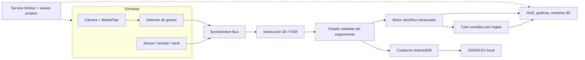
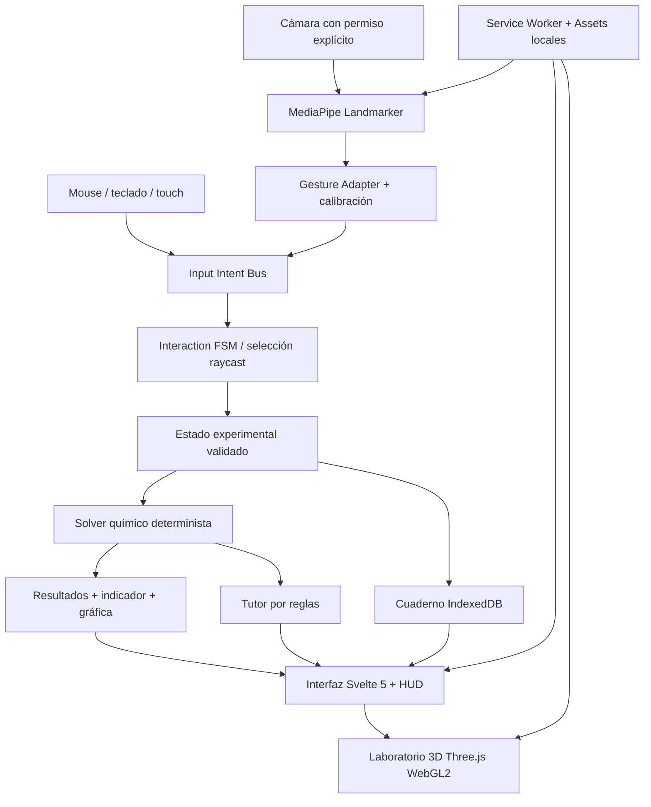

# SYMBIOLAB 2.0 — SDD CONSOLIDADO

**Spec-Driven Development, versión 0.2.0.** Estado: especificaciones propuestas, pendientes de aprobación e implementación.

Este consolidado reproduce en orden el texto de los archivos del paquete. Los contratos `.json` se incluyen en el ZIP estructurado, no en este texto.


---

## Archivo: `SymbioLab_Concepto_General.md`

# Concepto general definitivo propuesto — SymbioLab 2.0

## Identidad

- **Nombre:** SymbioLab — Laboratorio Científico Inmersivo, Gestual e Inteligente.
- **Lema sugerido:** «Tus manos son los instrumentos. Tu curiosidad es el laboratorio».
- **Usuarios:** estudiantes de secundaria, docentes de ciencia en escuelas vulnerables, aulas con conectividad intermitente y equipamiento heterogéneo.
- **Reto:** 17 (laboratorio donde no existe), más 02 (offline) y 04 (tutor socrático), conforme al planteamiento del equipo.
- **Categoría:** simulador educativo científico, primera persona, interacción natural, local-first; no un videojuego de combate ni una aplicación de chat.

## ¿Qué es?

SymbioLab convierte una computadora, tablet o smartphone compatible en un laboratorio virtual 3D que puede usarse sin conexión tras preparar su paquete local. Los estudiantes observan una mesa y sus instrumentos **desde sus propios ojos**, seleccionan y manipulan objetos como si trabajaran en un laboratorio, e investigan resultados provenientes de modelos científicos explícitos. Cuando el dispositivo lo permite, una cámara captura sus manos y un motor de gestos traduce pinzas, desplazamientos e inclinaciones en acciones sobre los instrumentos. Cuando no lo permite, el mismo experimento funciona mediante mouse, teclado o pantalla táctil.

El tutor no resuelve de inmediato: invita a plantear hipótesis, registrar variables, predecir efectos, observar resultados, justificar discrepancias y revisar evidencias. El cuaderno local registra lo sucedido, no conclusiones inventadas. En fases posteriores, experimentos en el mundo real con sensores y materiales accesibles permiten comparar la medición con el simulador.

## Experiencia central

1. Un estudiante abre SymbioLab y elige laboratorio **Química / Física / Biología / Electricidad / Ciencias Ambientales / Óptica y Ondas**. En el hackathon solo la estación de química será funcional end-to-end; las demás constarán en el roadmap, no como menús engañosos.
2. Entra a una estación 3D en primera persona. La mesa tiene objetos claramente etiquetados; puede enfocar su vista mediante ratón/táctil. Inicialmente no requiere navegación libre compleja.
3. Activa «Control con manos» y da consentimiento de cámara. El sistema detecta una mano y permite calibración visual.
4. Realiza el gesto de pinza para tomar un frasco, moverlo y verter un volumen controlado. Existe alternativa de botón/slider para precisión y accesibilidad.
5. SymbioLab actualiza cantidades y cálculos. En el MVP, mezcla **ácido fuerte/base fuerte idealizados** y calcula pH desde moles y volumen total, con un indicador virtual de color cualitativo.
6. El estudiante obtiene resultados, modifica una variable, repite el experimento y compara predicciones con resultados.
7. El tutor pregunta «¿Qué sucede con el pH si mantienes concentración y duplicas el volumen de base?» y registra hipótesis y evidencias.
8. Al finalizar, el cuaderno guarda valores, unidades, supuestos, gráfica y reflexión; se puede exportar sin servidor.

## Diferenciación competitiva defendible

La primera persona en 3D ya existe en simuladores comerciales. SymbioLab **NO** afirma haber inventado el laboratorio virtual ni que todas las alternativas son videos pregrabados. Su apuesta es un diseño conjunto de: (a) interacción gestual con webcam corriente, (b) modelos científicos verificables, (c) opción de mediciones reales con sensores ya disponibles, (d) funcionamiento offline, (e) hardware frugal, (f) tutor guiado por evidencia. La innovación reside en la **combinación**, cuya usabilidad e impacto deberán validarse.

## Visión por disciplinas

- **Química:** soluciones, dilución, indicadores, concentraciones, titulación didáctica, seguridad. No inferir pH real con HSV sin calibrar.
- **Física:** péndulo, movimiento, fuerzas, energía, colisiones, gráficas y comparación teórica.
- **Biología:** microscopía virtual con muestras preparadas, observación celular, crecimiento conceptual y clasificación; sin diagnóstico médico.
- **Electricidad:** circuito virtual con resistencias y fuentes seguras, voltímetro, análisis nodal comprobado; prohibido conectar a corriente de red en actividades reales.
- **Ciencias ambientales:** turbidez cualitativa, filtración, consumo de recursos, indicadores con límites; nunca declarar que un agua es potable por una cámara.
- **Óptica y ondas:** reflexión y refracción con modelos geométricos, frecuencia y amplitud, instrumentos digitales.

## Tres modos sin confundir sus capacidades

- **SymbioWorld:** entorno virtual tridimensional en primera persona sobre pantalla; *no* requiere casco VR.
- **SymbioTouch:** entrada por gestos con MediaPipe, local y opcional; no equivale a seguimiento 3D absoluto de manos.
- **SymbioReality:** puente de mediciones físicas y marcadores. Los overlays 2D sobre cámara pueden implementarse sin AR espacial completa; WebXR AR solo si se detecta soporte, como evolución.

## Valor agregado propuesto

1. **SymbioQuest:** método científico guiado (pregunta → hipótesis → variable → ensayo → evidencia → conclusión), con desafíos que premian razonamiento y no clics.
2. **Science Evidence Card:** ficha de cada experimento: algoritmo, supuestos, ecuación, unidad, incertidumbre, nivel de validez y versión del modelo.
3. **SymbioAdapt:** detector de capacidades del dispositivo con perfiles visuales básico/estándar y modos de control equivalentes.
4. **SymbioTeacher:** vista local para docentes con criterios de logro y exportación de evidencias seudónimas; requiere revisión de protección de datos antes de compartir.
5. **SymbioSafety:** capa de reglas de seguridad: manipulación virtual de sustancias peligrosas solo como aprendizaje conceptual, sin instrucciones operativas riesgosas.
6. **Laboratorios descargables:** módulos offline independientes; el aula no necesita descargar toda la biblioteca.
7. **Equidad gestual:** pruebas con manos, posiciones, luz y entornos diversos; la cámara nunca se utiliza para identidad o evaluación biométrica.

## Pitch en 30 segundos (propuesta, no promesa de implementación)

«¿Qué pasa cuando una escuela no tiene laboratorio? SymbioLab convierte su computadora con cámara en uno. Mira: tomo un frasco con mis dedos, mezclo dos soluciones virtuales y observo cómo cambia su pH. No es una animación prefijada: el cálculo depende de las cantidades que realmente elegí. Luego un tutor me pregunta *por qué* cambió. Todo sigue funcionando sin internet y, si no tengo cámara, utilizo controles tradicionales. La próxima fase conecta estas simulaciones con mediciones reales del aula».

## Límites y honestidad

No prometer compatibilidad universal en 2 GB, 60 FPS, pH colorimétrico exacto, WebXR en todos los móviles, «cero alucinaciones» o experiencias que ya existen en otros productos como exclusiva. El MVP proporciona modelado **pedagógico**, no acreditación analítica de laboratorio.


---

## Archivo: `README.md`

# SymbioLab 2.0 — Paquete de desarrollo guiado por especificaciones (SDD)

**Versión del paquete:** 0.2.0 — propuesta revisada · **Fecha:** 30 de octubre de 2026  
**Estado:** diseño preparado para revisión; **NO** implementado ni probado en hardware real.  
**Reto de referencia proporcionado por el equipo:** Hack4Edu, reto 17; sinergias retos 02 y 04 (sujetos a confirmación con las bases oficiales).

## Visión aprobable

**SymbioLab es un laboratorio científico virtual 3D en perspectiva de primera persona, local-first, donde estudiantes manipulan instrumentos mediante manos detectadas por cámara (SymbioTouch) o controles accesibles, ejecutan modelos científicos verificables, contrastan hipótesis y reciben tutoría socrática; sus funciones físico-digitales conectan el laboratorio virtual con mediciones reales.**

### Cambio de alcance frente a 0.1.0

La v0.1.0 priorizaba un péndulo físico con cámara y dejaba el 3D en segundo plano. Esta v0.2.0 **reemplaza el MVP**: escenario 3D en primera persona + interacción por gestos + química virtual con modelado explícito + tutor local + cuaderno offline, manteniendo un control tradicional completo. El péndulo pasa a Feature 002 y los sensores reales a Feature 003. Este cambio requiere revisión/aceptación del equipo antes de implementar.

### Tres modos de experiencia

1. **SymbioWorld (principal)**: laboratorio 3D en primera persona, estaciones científicas, herramientas arrastrables y simulación; NO exige VR.
2. **SymbioTouch (entrada)**: webcam o cámara detecta 21 puntos por mano vía MediaPipe; traductor de gestos controla agarre, traslado, inclinación y liberación. Requiere permisos; siempre existe alternativa ratón/táctil.
3. **SymbioReality (híbrido, iteración posterior)**: análisis de sensores reales y marcadores sobre papel; AR 3D completa opcional según soporte; el modo cámara 2D superpuesta no depende de WebXR.

### Los seis sistemas de producto

- **World & Interaction:** 3D optimizado en primera persona y objetos manipulables.
- **Gesture & Accessibility:** MediaPipe y controles de respaldo; diseño para diversidad motora y visual.
- **Science Engine:** modelos declarados con unidades, hipótesis, pruebas y límites.
- **Pedagogical Engine:** hipótesis → experimento → evidencia → reflexión; tutor socrático sin respuesta directa por defecto.
- **Reality Bridge:** comparación de mediciones reales y simuladas, con incertidumbre y calibración.
- **Offline Laboratory Notebook:** historial local exportable y módulos descargables.

## Entregable de 72 horas recomendado (P0)

Demostrar un **experimento químico virtual 3D con interacción gestual**: seleccionar frasco, tomarlo por pinza, verter líquido sobre un vaso, calcular cambio de pH en un **modelo didáctico de mezcla de ácido fuerte y base fuerte** (25 °C, disoluciones acuosas ideales), mostrar color del **indicador universal virtual**, generar preguntas sobre volumen y concentración, guardar/exponer evidencia científica **completamente offline tras instalación inicial**. Usar un solo banco de trabajo 3D en primera persona. No es espectrofotometría real.

**Criterio de supervivencia:** si la cámara falla o el reconocimiento es deficiente, el mismo experimento se completa mediante ratón, teclado o táctil. El núcleo científico jamás infiere volúmenes de forma implícita ni inventa mediciones.

## Alcance realista

| Estado | Funcionalidad |
|---|---|
| P0 hackathon / imprescindible | Primera persona en un banco 3D, selección y agarre, pinza de una mano, vertido por gesto y botón alternativo, modelo químico validado, color cualitativo virtual, tutor de reglas, persistencia y funcionamiento offline |
| P1 si P0 está estable | Péndulo virtual en otra estación; comparación física simple; medición real por cámara con calibración; analítica docente local |
| P2 | Biología, óptica, electricidad MNA, más compuestos y simulaciones verificadas; marcadores físicos 2D/AR opcional; dos manos |
| P3 | P2P local Yjs/WebRTC, SLM pequeño opcional tras evaluación, traducciones, sincronización en nube consentida, envoltorio Tauri |

## Directorio del paquete

- `.specify/memory/constitution.md`: principios de producto no negociables.
- `specs/000-product/spec.md`: experiencia completa y objetivos; fuera de alcance y criterios globales.
- `specs/001-chemistry-gestural-mvp/`: **especificación de producto**, plan técnico, investigación, modelo de datos, tareas, contratos y checklist del MVP.
- `specs/002-...` a `008-...`: futuras capacidades para preservar la visión sin comprometer P0.
- `docs/experience-blueprint.md`: concepto, recorrido por primera persona, estaciones, HUD, interacción, emociones, seguridad.
- `docs/architecture.md`: arquitectura y límites; flujo de captura, modelado y evidencias.
- `docs/roadmap.md`: prioridades por tiempo y definición de listo.
- `docs/test-matrix.md`: trazabilidad funcional y ensayos de dispositivos.
- `docs/adr/`: decisiones arquitectónicas documentadas.
- `AGENTS.md`: instrucciones para Codex, Gemini, OpenCode y otros agentes.
- `PROMPT_PARA_CODEX.md`: prompt para auditoría de especificaciones, no implementación automática.
- `SymbioLab_Concepto_General.md`: explicación del proyecto para docentes/jurado/equipo.

## Secuencia SDD

Constitution → Specify → Clarify → Plan → Checklist → Tasks → Analyze → Implement → Converge. **El paquete está redactado manualmente siguiendo esta estructura**; no se ha ejecutado `specify init` ni comandos de Spec Kit en un repositorio de código.

Antes de codificar: (1) aprobar constitución y Feature 001; (2) asignar dispositivos de prueba; (3) confirmar el modo de distribución offline; (4) resolver los requisitos pendientes en la checklist; (5) ejecutar análisis de consistencia. No se da por probado rendimiento, 2 GB, 60 FPS o precisión científica experimental.

## Referencias técnicas

- Spec Kit: https://github.github.com/spec-kit/ y https://github.github.com/spec-kit/reference/agentic-sdd.html
- MediaPipe Hand Landmarker web: https://developers.google.com/edge/mediapipe/solutions/vision/hand_landmarker/web_js
- MediaDevices getUserMedia: https://developer.mozilla.org/en-US/docs/Web/API/MediaDevices/getUserMedia
- PWA offline: https://developer.mozilla.org/en-US/docs/Web/Progressive_web_apps/Guides/Offline_and_background_operation
- Three.js WebGL: https://threejs.org/docs/#api/en/renderers/WebGLRenderer


---

## Archivo: `.specify/memory/constitution.md`

# Constitución de SymbioLab 2.0

**Versión 0.2.0 — propuesta pendiente de aprobación.** Todo requisito, diseño, tarea, recurso audiovisual, prompt de agente y demostración MUST respetar estos artículos.

## I. El producto es inmersivo y científicamente serio

La experiencia principal MUST ofrecer un escenario **3D en perspectiva de primera persona**, objetos físicos manipulables y resultados condicionados por variables de estado; un efecto visual o una secuencia prefijada nunca suplirá al motor científico. El MVP MAY restringir desplazamiento a una estación para ahorrar recursos, dejando claro el alcance.

## II. Entradas equivalentes y no discriminación

Los gestos son innovación central, pero MUST existir un recorrido funcional completo con ratón, teclado o táctil. La denegación de cámara, seguimiento perdido, extremidades no detectadas, distintas tonalidades de piel, iluminación variable o discapacidad motora no deberán impedir aprender. No usar manos/cámara para identidad biométrica.

## III. Evidencia científica, trazabilidad y errores

Toda salida calculada MUST identificar modelo, unidades, hipótesis, parámetros, versión, fuentes de entradas y límites de aplicación. Los modelos simplificados se etiquetan; no atribuir precisión instrumental a simulaciones pedagógicas. Valores inválidos o insuficientes generan error explícito, nunca estimaciones inventadas. Las representaciones gráficas no son prueba de exactitud.

## IV. Offline verificable

Todas las capacidades P0 MUST funcionar sin red tras una instalación/descarga inicial verificada y sin dependencias de CDN. Los recursos 3D, MediaPipe, modelo local, archivos WASM, fuentes y contenido se empaquetan o precachean. Un informe de instalación MUST indicar si faltan recursos. No asegurar persistencia ilimitada frente a políticas de eliminación del navegador.

## V. Hardware frugal como condición de diseño

WebGL 2 y materiales ligeros son punto de partida; efectos avanzados optativos. Reducir resolución dinámica, sombras, partículas y tasa de inferencia según perfil. FPS, RAM, latencia, tamaño de bundle y compatibilidad se consideran **hipótesis a medir**, nunca marketing sin evidencia.

## VI. Método científico y tutoría socrática

El producto MUST estructurar pregunta, hipótesis, variables, ejecución, evidencia y reflexión. Tutor inicial determinista por reglas; SLM local opcional tras pruebas y validación de fuentes. Nunca permitir que el texto de la IA altere resultados científicos ni suministre hechos no respaldados como certezas.

## VII. Privacidad y seguridad infantil

Cámara/micrófono solo bajo activación explícita; no guardar grabaciones crudas ni retransmitir video por defecto. No cuentas obligatorias, telemetría ni servicios de terceros en P0. Historial local y exportación controlada por usuario/docente. Contenido seguro para menores; no instrucciones reales de sustancias peligrosas, experiencias eléctricas de red o ingestión de muestras.

## VIII. Accesibilidad y localización

Español como idioma inicial, alto contraste, etiquetas no basadas solo en color, estado textual para eventos críticos, tamaño de controles apto para táctil, navegación con teclado. Tareas no exigirán únicamente agarre gestual. Adaptaciones de baja visión y audiodescripción se documentarán; añadirlas será priorizado por valor docente.

## IX. Contratos versionados y separación científica

Separar captura (MediaPipe), interpretación de gesto, intención, interacción 3D, motor científico, tutor y persistencia mediante contratos explícitos. La UI nunca será la fuente de verdad sobre química/física. Cambios de fórmulas, unidades o datos requieren pruebas de regresión y versión de modelo. Los IDs de objetos estables no son etiquetas visuales.

## X. Gates SDD y no sobredeclaración

Constitution → Specify → Clarify → Plan → Checklist → Tasks → Analyze → Implement → Converge. Ningún agente debe tratar archivos redactados como evidencia de código implementado. Cada FR MUST tener AC y pruebas; cada tarea tiene dependencia, salida verificable y estado. Cambios mayores se proponen en specification antes de implementarse.


---

## Archivo: `specs/000-product/spec.md`

# Spec 000 — Visión de producto SymbioLab 2.0

**Estado:** DRAFT · **Tipo:** especificación funcional global (QUÉ/POR QUÉ); el detalle tecnológico está en planes/ADRs.

## Problema

Centros educativos sin laboratorio, materiales, conectividad estable ni docentes especializados enfrentan dificultad para experimentar con ciencias. Un simulador 3D aislado no basta: la experiencia debe ser accesible, manipulable, verificable y educativa.

## Objetivo

Ofrecer estaciones científicas 3D en primera persona y laboratorios híbridos que permitan manipular variables, visualizar fenómenos bajo modelos reales, registrar evidencia y razonar socráticamente, incluso sin red en el aula tras instalar recursos.

## Audiencias

- Estudiante de 12–18 años (rango inicial de diseño, sujeto a revisión curricular), en escuelas con pocos recursos.
- Docente que inicia, supervisa, evalúa y comparte experimentos.
- Facilitador de aula comunitaria sin conexión estable.

## Historias transversales

- **US-G01 (P0):** Como estudiante quiero ver y manipular objetos 3D desde primera persona para actuar sobre un experimento, no solo observar una animación.
- **US-G02 (P0):** Quiero operar con cámara y manos cuando sea posible; si no, quiero controles equivalentes.
- **US-G03 (P0):** Quiero conocer qué modelo calculó el resultado, con variables y unidades.
- **US-G04 (P0):** Quiero hacer y revisar hipótesis sin recibir todas las respuestas del tutor.
- **US-G05 (P0):** Quiero retomar y exportar el experimento estando desconectado.
- **US-G06 (P1):** Quiero comparar una simulación con mediciones reales obtenidas con sensores existentes.
- **US-G07 (P2):** Como docente quiero planificar retos y evaluar evidencia sin recopilar videos ni biometría.

## Requisitos globales

| ID | Requisito | Prioridad | Verificación |
|---|---|---|---|
| G-FR-001 | Experiencia 3D subjetiva con objetos interactivos | P0 | T-G01 |
| G-FR-002 | Gestos de mano para control de instrumentos, con consentimiento | P0 | T-G02 |
| G-FR-003 | Input equivalente con ratón/teclado/táctil | P0 | T-G03 |
| G-FR-004 | Resultados derivados de modelo versionado y con unidades | P0 | T-G04 |
| G-FR-005 | Tutor socrático y registro de hipótesis | P0 | T-G05 |
| G-FR-006 | Instalable y operativo offline tras preinstalación | P0 | T-G06 |
| G-FR-007 | Cuaderno local exportable y privacidad | P0 | T-G07 |
| G-FR-008 | Perfiles de rendimiento y estado de recursos | P0 | T-G08 |
| G-FR-009 | Mediciones físicas reales etiquetadas y calibrables | P1 | T-G09 |
| G-FR-010 | Biblioteca modular de laboratorios por disciplina | P2 | T-G10 |
| G-FR-011 | Modo AR espacial solo tras soporte comprobado | P2 | T-G11 |
| G-FR-012 | Compartir/sincronizar opcional con consentimiento | P3 | T-G12 |

## Disciplinas previstas

Química; Física; Biología; Electricidad y Electrónica; Ciencias Ambientales; Óptica y Ondas. Un menú de futura funcionalidad **no** debe aparentar que está implementada. Los experimentos pueden reutilizar una API común, pero cada uno exige validación científica propia.

## Límites

- No pretende reproducir reacciones químicas arbitrarias ni simular un laboratorio real con exactitud industrial.
- No se debe proclamar «física diferenciable» sin un gradiente calculado y probado; simulación determinista no implica diferenciabilidad.
- No presupone WebGPU, VR, WebXR AR, dos manos, sensores específicos ni un modelo local pesado.
- No garantiza 2 GB/60 FPS hasta efectuar pruebas; puede ofrecer perfil Básico con menor fidelidad.

## Señales de éxito

Experimento P0 completo sin red, con al menos una acción gestual funcional y alternativa tradicional, resultado y ficha científica reproducibles, hipótesis/resultado recuperables, pruebas de modelos con fixtures, sin permisos encubiertos ni dependencias externas durante uso offline.

## Capacidades futuras

Consultar Specs 002–008 y `docs/roadmap.md`. No son compromisos de Hack4Edu P0.


---

## Archivo: `docs/experience-blueprint.md`

# Blueprint UX / interacción inmersiva

## Fantasía funcional (no VR)

«Entro al laboratorio, veo mis manos virtuales y trabajo sobre una mesa». Cámara virtual a altura de mesa, punto de vista subjetivo, profundidad moderada, instrumentos grandes, señalización legible, iluminación suave, resaltado de objetos al apuntar.

## Pantallas y recorrido

1. **Inicio / Selección:** Empezar química, continuar sesión, guía, estado offline, selección de control, perfiles.
2. **Preparación de estación:** reglas de seguridad, propósito y predicción; acceso a comprobación de cámara.
3. **Calibración gestual:** permiso explícito, imagen espejo opcional, distancia y luz, gesto pinza tutorial; botón «usar mouse».
4. **Laboratorio 3D:** instrumento en centro; HUD minimalista con volumen, pH virtual, concentración y unidades; panel de hipótesis plegable.
5. **Acción científica:** seleccionar frasco, agarrar, trasladar sobre vaso, inclinar, verter; confirmación sonora/visual opcional, evento deshacer antes de registrar ensayo.
6. **Análisis:** gráfica pH vs. volumen, datos teóricos, supuestos, preguntas socráticas, repetir con otras variables.
7. **Cuaderno:** entradas, fecha local, versión modelo, captura opcional del estado no de la cámara, export JSON/CSV.

## Controles por plataforma

| Acción | Gestos | Ratón/teclado | Táctil |
|---|---|---|---|
| Señalar | índice/mapeo pantalla | cursor | toque |
| Agarrar | pinza estable, soltando para liberar | clic y arrastre / tecla | mantener pulsado/arrastrar |
| Verter | inclinación mapeada de muñeca y zona del vaso | botón o slider cuantizado | botón + control de volumen |
| Elegir volumen exacto | control numérico accesible | control numérico | control numérico |
| Cambiar estación | no imprescindible por gesto | tecla/botón | botón visible |
| Deshacer | botón textual | Ctrl+Z | botón visible |

**Atención:** la estimación monocular de landmarks no produce posición absoluta precisa en centímetros. Mapeo 2D a plano de mesa, zona de destino y snap de objetos. Ninguna variación de profundidad se usa como medición química.

## Prioridades de motion design

- Microinteracciones claras (resaltado, chasquido visual, aproximación y vertido) y sonido opcional.
- No cámara nerviosa, motion sickness ni efectos que interfieran con lectura de datos.
- Gesto pinza con histéresis y permanencia mínima; pérdida breve de mano no suelta material de manera brusca; pérdida prolongada pausa la manipulación con instrucciones.
- Feedback inequívoco de «recipiente colocado / medición incorporada / volumen alcanzado / error de cámara».

## Integración pedagógica

Antes de verter: «¿Cómo esperas que cambie el pH?» Después: «¿Qué variable modificaste? ¿Cuál quedó constante?» El estudiante compara su hipótesis con el modelo en lugar de recibir felicitación por tocar un botón. Evaluación de proceso, no solo respuesta correcta.

## Estilo visual

3D estilizado semirrealista y legible, con instrumentos reconocibles y colores científicamente etiquetados; materiales PBR mínimos, geometría glTF simplificada, texturas comprimidas bajo pruebas. Desactivar sombras costosas en Básico. No prometer exactitud fotométrica del color mostrado en pantalla.


---

## Archivo: `docs/architecture.md`

# Arquitectura de referencia — SymbioLab 2.0

## Principio

Separar **captura** de **intención** de **estado científico** de **visualización**. No es aceptable que la posición visual de un frasco cambie números de química sin un evento validado por dominio.



## Fronteras y contratos

| Módulo | Entrada | Salida | Responsabilidad |
|---|---|---|---|
| `CaptureAdapter` | permisos, video frames efímeros | landmarks / calidad | gestión de cámara sin retención |
| `GestureInterpreter` | landmarks + tiempo | `GestureEvent` | estados pinza/soltar y filtro |
| `InputIntentBus` | gesto/ratón/táctil | `InteractionIntent` | normalización y accesibilidad |
| `ObjectInteractor` | intent + raycast/volumen | evento validado | límites y transición de estado |
| `ScienceEngine` | estado experimental validado | `ChemistryResult` | única autoridad matemática |
| `TutorEngine` | diagnóstico y evidencia | pregunta versionada | pedagogía sin números inventados |
| `Notebook` | eventos/resultados | datos locales/export | persistencia y minimización |
| `View3D` | estado observado | escena y HUD | representación, no solvers |

## Versionado científico

Todo experimento contiene `experimentId`, `modelId`, `modelVersion`, `schemaVersion` y `assumptions[]`; migraciones documentadas. Los resultados históricos deben poder interpretarse aunque el modelo cambie. Los cálculos nunca leen datos directamente del DOM.

## Escalabilidad modular posterior

`experiments/chemistry`, `/physics`, `/biology`, `/electricity`, `/environmental`, `/optics`; cada módulo aportará contenido, objetos, `ExperimentModel`, guía, fixtures y test pedagógico. Agregar un menú no equivale a completar un módulo.

## Notas sobre tecnología

- Rust/WASM no obligatorio para resolver la ecuación analítica P0; TS puro auditable evita bytes de más.
- MediaPipe puede demandar CPU significativa; detección sincrónica en UI es un riesgo conocido, trasladar a Worker si plataforma lo admite.
- WebGL 2 es baseline; WebGPU y WebXR optativos según capacidades.
- PWA no garantiza almacenamiento permanente; ofrecer exportación local y checklist de cache.
- Una cámara monocular estima pose relativa, no pinza espacial submilimétrica.


---

## Archivo: `docs/DECISIONES_POR_APROBAR.md`

# Puertas de decisión (Spec-Driven Development)

**Propuesta pendiente de aprobación**, no bloquea lectura/análisis.

## Decisiones resueltas por la visión expresada

1. 3D en primera persona **sí** es el centro, no una animación 2D.
2. Gestos de mano mediante cámara/MediaPipe **sí** son diferenciador central; voluntarios y con alternativa.
3. AR **no** reemplaza el laboratorio 3D; modo híbrido futuro según compatibilidad.
4. La plataforma debe funcionar sin internet tras instalar los assets necesarios.
5. Los temas contemplan química, física, biología, electricidad, ciencias ambientales y óptica/ondas.

## Defaults técnicos elegidos para facilitar 72 h (a ratificar)

- Primer experimento: **química ácido fuerte/base fuerte virtual** con indicador universal ilustrativo, no pH de cámara.
- MVP: banco de química en perspectiva subjetiva, no edificio abierto.
- Primera plataforma de demo sugerida: laptop con webcam + Chrome/Chromium; Android se prueba pero no se promete universalidad.
- Gesto MVP: una mano, pinza y movimiento; giro/vertido si supera ensayo; siempre control preciso alternativo.
- Tutor: preguntas por reglas; SLM no necesario.
- Motor: ecuación analítica TypeScript, Rust/WASM sólo tras necesidad demostrada.

## Pendientes concretos para el equipo

| ID | Decisión | Default sugerido | Por qué importa |
|---|---|---|---|
| D-01 | Dispositivo real de demo | laptop con webcam | perfil GPU, permisos, fps |
| D-02 | Rango/volúmenes del simulador | 0.01 M, frascos de 100 mL, vaso de 250 mL | límites del solver y material pedagógico |
| D-03 | Gesto de vertido | inclinar en zona; respaldo slider | evitar vertido involuntario |
| D-04 | Tutor explica respuesta cuándo | solo después de hipótesis y solicitud | mantener enfoque socrático |
| D-05 | Idiomas en demo | español | alcance viable |
| D-06 | Distribución offline | precache por HTTPS/LAN antes de iniciar | demo repetible |
| D-07 | Nivel de evidencia científica | revisión con docente STEM | evitar promesas indebidas |

## Autorización que se busca

- Aprobar Constitución 0.2.0.
- Aprobar Feature 001 con los defaults y riesgos declarados.
- Autorizar auditoría técnica de artefactos y, después de ella, implementación T-001–T-026.


---

## Archivo: `specs/001-chemistry-gestural-mvp/spec.md`

# Spec 001 — MVP laboratorio químico 3D gestual y offline

**Versión:** 0.2.0 · **Estado:** DRAFT (esperando aprobación)  
**Tipo:** requisitos funcionales (QUÉ y POR QUÉ). Consultar `plan.md` para selección tecnológica.

## 1. Problema y objetivo

Un estudiante en un aula sin laboratorio necesita **manipular** y comprender variables científicas, en vez de limitarse a pulsar «ejecutar simulación». La experiencia debe funcionar sin cámara y sin internet después del precache inicial.

**Definición del MVP:** una estación química 3D en primera persona con vaso, dos frascos de reactivos virtuales, un indicador universal virtual, una interfaz gestual de una mano, un motor para calcular el pH de mezcla ideal ácido fuerte/base fuerte, tutor socrático por reglas y cuaderno local. No pretende química universal ni experimento físico de sustancias reales.

## 2. Historias de usuario con aceptación

### US-001 — Estación 3D en primera persona (P0)

- **AC-001.1** Abrir «Laboratorio de Química» presenta mesa, vaso, frascos y datos legibles desde una cámara virtual subjetiva. El estudiante puede mirar lateralmente o cambiar foco; **no** necesita caminar libremente por un edificio.
- **AC-001.2** Cada material tiene nombre y propósito; al focalizar se muestra objeto seleccionable y el estado es perceptible sin depender solo del color.
- **AC-001.3** Al bajar el perfil de rendimiento, los objetos siguen siendo manipulables y los datos interpretables.

### US-002 — Consentimiento y calibración de manos (P0)

- **AC-002.1** Nunca se activa la cámara antes de una acción afirmativa del usuario, y hay opción visible «continuar sin cámara».
- **AC-002.2** Con consentimiento, una mano visible puede señalar sobre el área de trabajo y completar una calibración de pinza; el cursor refleja el estado de seguimiento.
- **AC-002.3** Si desaparece la mano, cambia la iluminación o el usuario revoca permiso, la acción se pausa o cancela de forma segura y el modo alternativo queda disponible.
- **AC-002.4** Ningún frame de cámara es guardado ni subido a servidor por defecto.

### US-003 — Manipular y verter con manos (P0)

- **AC-003.1** Una pinza mantenida durante un intervalo configurable sobre un frasco seleccionable lo toma; el HUD confirma «frasco agarrado».
- **AC-003.2** Mientras mantiene la pinza, puede moverlo; al orientar el frasco sobre la zona de vertido y ejecutar el gesto de inclinación dentro de umbrales se incrementa el volumen **solo** dentro de límites del recipiente y por una función determinista calibrada.
- **AC-003.3** Soltar la pinza deja el objeto en posición permitida y deja de verter. Pérdidas breves del tracking no vuelcan cantidades por error; tras pérdida prolongada se pausa y exige confirmación.
- **AC-003.4** La misma tarea (seleccionar, verter cantidad y soltar) puede ejecutarse sin cámara usando controles equivalentes y volumen exacto.
- **AC-003.5** No es posible añadir volumen negativo, superior a disponibilidad ni mayor que la capacidad del vaso; acciones inválidas muestran explicación.

### US-004 — Cálculo científico verificable (P0)

- **AC-004.1** El sistema muestra especies «ácido fuerte idealizado» y «base fuerte idealizada», concentraciones (mol/L), volúmenes (mL), temperatura de referencia 25 °C, pH simulado y cantidad acumulada.
- **AC-004.2** El resultado depende de `n_acido=C_a·V_a` y `n_base=C_b·V_b`, en litros, y del modelo de electroneutralidad con `K_w=1e-14` a 25 °C; no depende de respuestas lingüísticas de IA.
- **AC-004.3** Para agua pura virtual de volumen positivo y sin ácido/base el resultado pH ≈ 7; los casos ácido en exceso, equivalencia y base en exceso corresponden con fixtures científicos previamente acordados.
- **AC-004.4** Cualquier concentración fuera de rango o entrada no finita se rechaza. La interfaz indica claramente «modelo educativo idealizado, no predicción de química real arbitraria».
- **AC-004.5** El color del indicador universal virtual es una representación **categórica** de pH por bandas, no medición espectrofotométrica ni cuantificación de pH con cámara.

### US-005 — Método científico guiado (P0)

- **AC-005.1** Antes de verter, el usuario registra una predicción sobre la tendencia del pH y puede elegir la variable que cambiará.
- **AC-005.2** Después de verter, el sistema pregunta cómo se relacionan volumen, concentración y resultado antes de mostrar una explicación final bajo demanda.
- **AC-005.3** Cada pregunta procede de una categoría calculada (`acid_excess`, `near_equivalence`, `base_excess`, `no_data`, `invalid_input`) y tiene acceso a datos verificables. No requiere LLM remoto ni SLM local.
- **AC-005.4** Ante estado desconocido el tutor pide nuevos datos; no inventa valores.

### US-006 — Cuaderno, offline y seguridad (P0)

- **AC-006.1** Una instalación con recursos completos permite ejecutar un experimento nuevo, guardar, recuperar y exportar en modo avión, sin peticiones a internet durante el flujo.
- **AC-006.2** Cada ensayo conserva entradas, salidas, modelo/version, método de control, hipótesis, evento temporal y limitaciones. Se puede exportar JSON y CSV con unidades.
- **AC-006.3** Si falla la persistencia por cuota o privacidad, se avisa, se conserva la sesión en memoria mientras sea posible y se ofrece exportación directa.
- **AC-006.4** La cámara se libera al salir de modo gestual; no se hacen llamadas a nube, analítica o servicios de terceros en el MVP.

## 3. Requisitos funcionales y prioridades

| ID | MUST/SHOULD | Requisito | Aceptaciones |
|---|---|---|---|
| FR-001 | MUST | estación 3D subjetiva y legible | AC-001.1–1.3 |
| FR-002 | MUST | objetos interactivos con estados visuales | AC-001.2, AC-003.1 |
| FR-003 | MUST | consentimiento y revocación de cámara | AC-002.1, AC-002.4 |
| FR-004 | MUST | detección de una mano y calibración | AC-002.2–2.3 |
| FR-005 | MUST | pinza, mover, verter y soltar con control de errores | AC-003.1–3.3 |
| FR-006 | MUST | controles de respaldo equivalentes | AC-003.4 |
| FR-007 | MUST | invariantes de volumen y concentración | AC-003.5, AC-004.4 |
| FR-008 | MUST | solver ácido/base determinista con ficha modelo | AC-004.1–4.4 |
| FR-009 | MUST | indicador universal virtual etiquetado | AC-004.5 |
| FR-010 | MUST | hipótesis y tutor por reglas | AC-005.1–5.4 |
| FR-011 | MUST | cuaderno local y exportación | AC-006.2–6.3 |
| FR-012 | MUST | uso offline tras preparación de recursos | AC-006.1 |
| FR-013 | MUST | privacidad, liberación de cámara y ausencia de backend | AC-006.4 |
| FR-014 | SHOULD | gráfica pH vs volumen con tabla accesible | AC-004.1 |
| FR-015 | SHOULD | deshacer último vertido / reinicio de ensayo | AC-003.3 |

## 4. Modelo didáctico acotado

Los reactivos del experimento son **soluciones virtuales de ácido fuerte monoprótico (HCl acuoso idealizado) y base fuerte monovalente (NaOH acuoso idealizado)**. No se enseña a realizarlo físicamente ni se suministran procedimientos de manejo de sustancias reales peligrosas.

En volumen total `V_L > 0`, con concentraciones en `mol/L` y volúmenes en `L`, definir `d = (C_a V_a − C_b V_b)/V_total`, concentración molar de exceso ácido firmada. A 25 °C, `K_w = 1e−14`; con `H=[H⁺]`: `H² − dH − K_w = 0`. Calculamos la raíz positiva evitando cancelación numérica cuando `d<0`: `H=(d+sqrt(d²+4K_w))/2` si `d>=0`; en otro caso `H=2K_w/(sqrt(d²+4K_w)−d)`. `pH=-log10(H)`.

**Hipótesis:** ácido/base fuertes disociados, sistema homogéneo, actividad≈concentración, dilución ideal, temperatura fija, sin buffers, CO2, precipitación ni reacciones laterales. No usar pH mostrado como dato de sensor. Efectos de partículas o efervescencia decorativos no deben sugerir productos químicos inexistentes.

El color del indicador universal se modela con bandas pedagógicas versionadas; color RGB del monitor no constituye una medida física. Si se usa col morada real en una evolución, se calibrará por separado y producirá inicialmente categoría cualitativa.

## 5. NFR y gates de calidad (objetivos, no resultados)

- **NFR-001:** en dispositivo de referencia por definir, interacción 3D perceptiblemente fluida; medir frame time, dropped frames, memoria, latencia de gesto. Objetivo inicial: mediana ≥24 FPS en perfil Básico y sin bloqueo de >500 ms; ajustar tras prueba. **No** prometer 60 FPS ni operación en todo equipo con 2 GB.
- **NFR-002:** detección de mano al ritmo adaptativo que tolere carga de CPU (meta de evaluación 10–20 inferencias/s en perfil Básico), con evitar ejecución bloqueante sobre UI cuando sea posible; plan de contingencia si Worker no permite transferir video como previsto.
- **NFR-003:** probar en Chromium Android y Chrome/Chromium escritorio con webcams disponibles. iOS/Safari, WebXR y Tauri fuera de soporte P0 hasta validación independiente.
- **NFR-004:** cámara bajo HTTPS o localhost y permiso explícito; modelos, WASM y assets locales.
- **NFR-005:** texto legible, control por teclado y alternativas no gestuales; contraste y no dependencia única del color.
- **NFR-006:** sesiones compartibles solo por exportación intencional; registros del tracking efímeros y no biométricos.

## 6. Matriz de casos extremos (obligatoria)

Permiso rechazado; cámara no detectada; dos manos entrando cuando configurada una; pinza intermitente; manos fuera del campo; baja iluminación; falso positivo de pinza; frasco fuera de zona; giro rápido; tracking pausado; navegador suspende pestaña; cambio horizontal/vertical; pérdida de WebGL; cero volumen; división por cero; NaN; concentraciones negativas; volumen agotado; depósito lleno; cuota de IndexedDB; caché incompleta; instalación offline no preparada.

## 7. Fuera de alcance de Feature 001

Navegación en edificio abierto, dos manos simultáneas, seguimiento 3D de profundidad métrica, AR espacial, lectura exacta de pH con cámara, química arbitraria, acústica Doppler P2P, biología, circuitos analógicos generalizados, LLM local obligatorio, sincronización, cuenta, nube, gafas VR o sustancias reales.

## 8. Resoluciones pendientes antes de implementar

- Confirmar hardware de presentación y tamaños de pantalla para pruebas; proveedor de cámara y soportes.
- Acordar umbrales gestuales iniciales y permitir calibración por usuario, no valores universalmente fijos.
- Confirmar si la demostración será en laptop con webcam (recomendado) y si habrá mouse de respaldo.
- Confirmar límites didácticos de concentración/volumen con el docente y composición de tareas evaluativas.
- Decidir si el indicador universal representado se asume añadido desde el inicio o mediante instrumento virtual aparte.

En ausencia de respuesta, los defaults del plan permiten continuar con **diseño y pruebas del solver**, pero no declarar Feature 001 aprobada para implementación.


---

## Archivo: `specs/001-chemistry-gestural-mvp/research.md`

# Research y validaciones pendientes (Feature 001)

| Tema | Evidencia conocida | Decisión propuesta | Validación pendiente |
|---|---|---|---|
| MediaPipe Hand Landmarker web | 21 landmarks/mano, inferencia sincrónica según guía de Google | detección local con umbral adaptativo y Worker exploratorio | verificar worker/video transferable en navegadores objetivo; pruebas de luz y tonos diversos |
| Primera persona | Canvas WebGL 2 soportado en navegadores modernos, con variaciones | cámara fija/subjetiva junto a banco, control orbital limitado, glTF básico | medida de FPS, consumo y contexto perdido |
| Input gestual | coordenadas relativas y profundidad aproximada, no sensor espacial métrico | mapeo a plano 2D, raycast contra frascos, snap de vertido | falsos positivos y fatiga tras 5 min |
| Química | solución analítica equilibrio fuerte ácido/base ideal | solver TypeScript puro y testeado, Rust/WASM solo si necesario | validar fixtures contra cálculo independiente |
| Offline | Service workers/cache e IndexedDB | precache de recursos core con chequeo integridad y pantalla de preparación | modo avión, caché incompleta/evictada, cuota |
| Reactividad | Svelte/TypeScript práctico para UI | app frontend Svelte 5; Three.js escena; UI modular | tamaño de paquete con assets reales |
| Renderizado | WebGPU con soporte desigual; WebGL 2 ampliamente viable | WebGL 2 para P0, WebGPU optativo después | matrix de GPU/browser |
| Tutor | LLM no asegura cálculo exacto, pesada descarga offline | preguntas deterministas por reglas | revisión docente de todas las preguntas |

## Hipótesis de producto a poner a prueba

- H1: usuarios sin experiencia pueden realizar una mezcla con gestos tras tutorial breve; se requiere prueba observacional, no dato inventado.
- H2: alternativa mouse/táctil permite completar idéntica tarea con claridad.
- H3: el incremento de volumen por inclinación es controlable en un ambiente de webcam; si no, sustituir gesto por pinza+mover y control de vertido numérico.
- H4: el valor innovador de combinar gestos, modelo, offline y tutor es observable por el jurado; no se afirma exclusividad de mercado.
- H5: modo de primera persona en espacio limitado se percibe como inmersivo; mejorar locomoción no tiene prioridad sin validación.

## Fuentes técnicas para revalidación

1. https://developers.google.com/edge/mediapipe/solutions/vision/hand_landmarker/web_js
2. https://developer.mozilla.org/en-US/docs/Web/API/MediaDevices/getUserMedia
3. https://developer.mozilla.org/en-US/docs/Web/Progressive_web_apps/Guides/Caching
4. https://threejs.org/manual/pages/webgpurenderer
5. https://github.github.com/spec-kit/reference/agentic-sdd.html

Todas las cifras de rendimiento que aparezcan en pitch requerirán bitácora con SO, modelo de dispositivo, memoria, resolución, navegador y fecha.


---

## Archivo: `specs/001-chemistry-gestural-mvp/plan.md`

# Plan técnico — Feature 001 (CÓMO)

**Estado:** borrador sujeto a aprobación de Spec 001. Se evita incorporar dependencias por novedad sin evidencia de necesidad.

## Arquitectura mínima



## Capas/paquetes

- `src/lib/core/contracts/`: tipos, JSON schemas, IDs versionados.
- `src/lib/input/camera/`: consentimiento, start/stop de stream, sistema de permisos.
- `src/lib/input/hand/`: MediaPipe adapter, normalización izquierda/derecha, landmarks efímeros, calidad.
- `src/lib/input/gestures/`: detector de pinza, seguimiento y filtro temporal/histéresis.
- `src/lib/input/intent/`: normalizador a `select/grab/move/pour/release/cancel` independiente del dispositivo.
- `src/lib/lab3d/`: escena WebGL 2, glTF, raycast, foco y sprites HUD.
- `src/lib/interaction/`: FSM de objeto y restricciones, control de vertido.
- `src/lib/science/chemistry/`: función pura con `strong-acid-base-25C-v1` y pruebas fixtures.
- `src/lib/education/`: hypothesis, diagnósticos, preguntas socráticas versionadas.
- `src/lib/storage/`: repositorio IndexedDB y serialización/exportación.
- `src/routes/`: pantallas inicio / laboratorio / análisis / cuaderno.
- `static/models/`, `static/models/mediapipe/`, `static/assets/`: recursos versionados para uso offline.

## Pila propuesta y razones

- **Svelte 5 + TypeScript + Vite/SvelteKit**: aplicación web responsiva. La entrada sin conexión debe probarse con empaquetado client-side apropiado; no depender de SSR de servidor.
- **Three.js + WebGL 2**: 3D básico desde primera persona. **No obligar WebGPU**; shaders complejos y post-procesado fuera del MVP.
- **MediaPipe Tasks Vision / Hand Landmarker**: landmark tracking; modelo y dependencias empacados localmente; `detectForVideo` sincrónico, explorar Worker con medición antes de elegir estructura. Web worker no garantiza mejora en todos los navegadores.
- **Motor gestual propio:** calcular pinza normalizada a tamaño de palma, suavizar cursor y asegurar transiciones de estado estables. Filtrar frames de baja confianza. No utilizar `z` como altura métrica del frasco.
- **Modelo químico en TypeScript puro:** con 2 reactivos y ecuación analítica no hace falta WASM; introducir Rust/WASM en módulos futuros que lo justifiquen por benchmark.
- **IndexedDB** (con wrapper mínimo opcional): persistencia local; export JSON/CSV; Service Worker y caché versionada de assets; no requerir servidor, CDN ni login.
- **Tutor de reglas**: se alimenta exclusivamente de `ChemistryResult`, de entradas validadas y de la hipótesis.

## FSM de manipulación

```text
IDLE -> HOVER -> PINCH_CANDIDATE -> GRABBED -> POUR_READY -> POURING -> GRABBED -> RELEASED
                 \-> IDLE             \-> PAUSED_TRACKING -> RESUME_CONFIRM | CANCEL
```

- Pinza = distancia(normalizada, índice-pulgar) por debajo de `closeThreshold` durante `stableMs`; liberar cuando supera `openThreshold` durante `releaseMs`; `openThreshold > closeThreshold` (histéresis).
- Añadir umbral de calidad del seguimiento y `trackingLostMs` para pausa segura.
- Selección por raycaster/área sensible; `pour` solo si frasco está en zona válida, inclinación sobre umbral y estado `GRABBED`. El vertido se cuantiza por tiempo (`rateMlPerSecond × deltaTime`) **acotado** a volumen disponible y capacidad del vaso.
- La misma acción intencional está disponible con control numérico y botón para movilidad reducida; en MVP tolerar uso de mouse para vertido si el giro gestual es inestable.
- Cada cambio de estado emite `InteractionEvent` validable y la escena solo observa esos eventos.

## Solver P0

API pura `calculateStrongAcidBase(state: ChemistryInput): ChemistryResult | DomainError`.

1. Validar `V_total_L > 0`, `C_a,C_b >=0`, números finitos, temperatura fija 25 °C.
2. `d=(Ca*Va − Cb*Vb)/V_total`, con volumen en litros.
3. `H=(d+sqrt(d²+4Kw))/2` si `d>=0`, else `H=2Kw/(sqrt(d²+4Kw)−d)`; `Kw=1e−14`.
4. `pH=-log10(H)`; generar bandas (`0–3`, `3–6`, `6–8`, `8–11`, `11–14`) ilustrativas y clase diagnóstica según exceso.
5. Registrar fórmula, supuestos, precisión numérica, rango, warnings. Entradas de alta concentración fuera de actividad se rechazan o advierten, no se extrapolan arbitrariamente.
6. Recalcular tras evento confirmado; gráfica en Canvas/SVG ligera con tabla alternativa; la escena visual no altera cálculos.

**Fixtures de regresión estimados (confirmar con solver independiente):** agua pH≈7; ácido 0.01 M puro pH≈2; base 0.01 M pura pH≈12; volúmenes iguales 0.01 M + 0.01 M pH≈7. Los tests validan aritmética del modelo, no exactitud química fuera de hipótesis.

## Render y rendimiento

- Una estación; 3D estilizado low-poly legible, sin texturas grandes, un vaso, dos frascos y herramientas básicas.
- LOD básico/estándar, render scale dinámico, no SSR, efectos visuales opcionales.
- El render se desacopla de la inferencia. Evitar solicitar detección a cada refresh de pantalla si la carga sube.
- Cerrar pistas de video con `track.stop()`; no tomar frames para almacenamiento.
- Fallback automático a entrada sin cámara cuando el costo CPU/memoria excede tolerancias observadas.

## Seguridad y datos

- Consentimiento before camera; no audio en Feature 001.
- Recursos empaquetados y hash de manifest para comprobar offline readiness.
- Validar entradas numéricas, estados y persistencia; exportación solo por interacción explícita.
- Usar seudónimos y evitar nombres/documentos, geolocalización o identificación biométrica.
- Primera instalación puede requerir internet, USB o servidor LAN: offline **posterior** es el requisito.

## Integración/CI propuesta

- Unit tests: solver, límites de vertido, FSM, tutor, serialización.
- Contract tests: schemas JSON + fixtures.
- Integración: modo manual y gestual con cámara simulada; IndexedDB.
- E2E: PWA modo avión, volver a abrir, recuperar/exportar; casos de permiso denegado.
- Manual en hardware: frame rate, latencia, tipos de iluminación, modos táctiles y pérdida de seguimiento.

## Política de cambios

Si en 72h el gesto de inclinación es demasiado inestable, el mínimo aceptable mantiene **pinza para seleccionar/trasladar** y vertido por HUD explícito. Requiere registrar la desviación respecto de AC-003.2 y negociar ajuste de alcance; no se declara cumplido silenciosamente.


---

## Archivo: `specs/001-chemistry-gestural-mvp/data-model.md`

# Modelo de datos — Feature 001

## Entidades

### `LabSession`

`id(UUID)`, `schemaVersion`, `createdAt`, `updatedAt`, `experimentId`, `experimentVersion`, `deviceProfile`, `inputMode`, `hypothesisText?`, `prediction?`, `events[]`, `trials[]`, `lastResult?`, `reflectionText?`, `status(draft|completed|invalid)`, `language`.

### `Reagent`

`reagentId`, `kind(strong_acid|strong_base|water)`, `name`, `concentrationMolPerL>=0`, `remainingMl>=0`, `initialMl`, `modelId`, `label`, `hazardNotice`. Definidos en catálogo local versionado, sin sustancias arbitrarias en P0.

### `BeakerState`

`capacityMl>0`, `waterMl>=0`, `acidVolumeMl>=0`, `baseVolumeMl>=0`, `temperatureC=25`, `indicatorId=universal-virtual-v1`, `modelId=strong-acid-base-25C-v1`.

### `InteractionEvent`

`eventId`, `kind(select|grab|move|pour|release|reset|input_mode_change)`, `objectId`, `inputMode`, `timestampMs`, `requestedMl?`, `appliedMl?`, `status(applied|rejected|paused)`, `reason?`. No guardar landmarks crudos persistentes ni frames.

### `ChemistryResult`

`modelId`, `modelVersion`, `inputSnapshot`, `pH`, `excessConcentrationMolPerL`, `class(acid_excess|near_equivalence|base_excess)`, `indicatorBand`, `assumptions[]`, `warnings[]`, `computedAt`.

### `TutorTurn`

`strategyId`, `diagnosticClass`, `question`, `supportedByEventId?`, `studentResponse?`, `version`. La pregunta nunca crea variables del solver.

## Invariantes

- `0<=remainingMl<=initialMl`; `0<=beakerTotalMl<=capacityMl`; `temperatureC=25` en MVP.
- `concentrationMolPerL` finita y dentro del rango configurado de la actividad; no NaN/Infinity.
- Cantidad vertida = mínimo entre cantidad solicitada, disponible y capacidad libre; si <=0, no se modifica estado.
- La mezcla se actualiza **antes** de calcular pH; los resultados provienen de `state` validado, no de animación ni inferencia de pose.
- `inputMode` influye en la forma de introducir volumen, nunca en la fórmula científica.
- Cada evento confirmado conserva una identidad idempotente; replays no duplican volúmenes.
- La fuente `gesture` no implica que volumen = medida real: se etiqueta «control virtual por gesto».

## Contratos

- `contracts/gesture-intent.schema.json`: normaliza entradas gesture/mouse/touch a acciones.
- `contracts/chemistry-input.schema.json`: inputs exactos al modelo.
- `contracts/chemistry-result.schema.json`: output verificable y warnings.
- `contracts/lab-session.schema.json`: persistencia del cuaderno.

**Nota:** JSON Schema valida tipos/rangos básicos; invariantes entre campos, unidades y umbrales científicos requieren validadores de aplicación y tests.


---

## Archivo: `specs/001-chemistry-gestural-mvp/tasks.md`

# Tasks — Feature 001 (plan dependiente, estado TODO)

**IMPORTANTE:** tareas **planeadas**, no implementadas. Antes de ejecutarlas: aprobar Constitución/Spec, resolver incógnitas relevantes, pasar checklist y Analyze.

## H0 — Preparación y reglas (0–6 h orientativas, NO compromiso)

- [ ] **T-001** [G-FR-001, FR-001] Inicializar repo, Svelte/TS, linter, test runner, estructura por capas; comprobar arranque local.
- [ ] **T-002** [FR-008] Crear fixtures de entradas/respuestas científicas, archivo versionado de supuestos y método de verificación independiente.
- [ ] **T-003** [FR-013] Instalar CSP, política de permisos, eliminación de telemetría/red y control de assets locales.
- [ ] **T-004** [FR-012] Crear manifest de recursos, Service Worker y flujo de “preparación offline completa”.

## H1 — Núcleo científico y datos (bloqueantes)

- [ ] **T-005** [FR-007, FR-008] Implementar tipos/validadores de concentración, volumen, temperatura e invariantes; tests de NaN, cero, capacidades y negativos.
- [ ] **T-006** [FR-008, AC-004.1–4.4] Implementar solver puro de ácido/base, fixtures ácido/neutro/base y tests de estabilidad numérica.
- [ ] **T-007** [FR-009, AC-004.5] Implementar bandas visuales categóricas del indicador virtual, aviso de modelo ideal y equivalencias textuales.
- [ ] **T-008** [FR-011] Implementar repositorio de cuaderno IndexedDB con pruebas de persistencia/capacidad/export.
- [ ] **T-009** [FR-010] Implementar estado pedagógico, preguntas socráticas por clases de diagnóstico, tests de “sin datos”.

## H2 — Inmersión 3D y controles alternativos

- [ ] **T-010** [FR-001] Construir banco de química con cámara en primera persona, vaso y dos frascos 3D identificables.
- [ ] **T-011** [FR-002] Raycast, highlight, tooltip, snapping y máquina de estados de objetos.
- [ ] **T-012** [FR-006] Controles mouse/táctil/teclado que ejecuten mismo `InteractionIntent` y permitan un experimento completo.
- [ ] **T-013** [FR-005, FR-007] Gestionar vertido en función del estado y cantidad: límite de capacidad, rate, pause/cancel, retroalimentación y pruebas.
- [ ] **T-014** [FR-014] HUD de unidades y resultados; gráfica ligera + tabla equivalente.

## H3 — Input por MediaPipe e integración (alto impacto)

- [ ] **T-015** [FR-003] Consentimiento explícito de webcam, iniciar/detener stream, errores y no guardar frames.
- [ ] **T-016** [FR-004] Cargar WASM/modelo MediaPipe **local**, detectar una mano y mostrar telemetría de calidad efímera.
- [ ] **T-017** [FR-004, FR-005] Adaptador palm-normalized, pinza, filtro temporal, histéresis, tracking perdido y calibración configurable.
- [ ] **T-018** [FR-005] Vincular gesto a selección, agarrar, movimiento sobre mesa y liberar con tests usando landmarks sintéticos.
- [ ] **T-019** [FR-005] Integrar inclinación/vertido o confirmar fallback de volumen por HUD como desviación registrada; test de vertido accidental.
- [ ] **T-020** [FR-003, FR-006] Probar mismo escenario con cámara negada y entrada manual, sin bloqueo de aprendizaje.

## H4 — Pedagogía, cuaderno y presentación

- [ ] **T-021** [FR-010] Flujo hipótesis → ensayo → pregunta → reflexión → revisión.
- [ ] **T-022** [FR-011] Cuaderno recuperable y export JSON/CSV con versión modelo/unidades/limitaciones.
- [ ] **T-023** [FR-012] Ensayar instalación inicial, cerrar navegador, modo avión, abrir PWA y ejecutar escenario nuevo offline.
- [ ] **T-024** [FR-001, NFR-001] Perfiles básicos de GPU, reducción de render scale y prueba FPS/latencia con bitácora por dispositivo.
- [ ] **T-025** [FR-013] Revisión de permisos, red y almacenamiento de cámara; auditar `getUserMedia` y parada de tracks.
- [ ] **T-026** [FR-001–FR-013] Auditoría E2E en hardware de presentación, incluyendo demo de jurado y fallback mouse inmediato.

## H5 — Opcionales SOLO si P0 supera gates

- [ ] **T-027** [FR-015] Undo de último vertido con event sourcing acotado.
- [ ] **T-028** [FR-014] Gráficas mejoradas y narrativa de resultados.
- [ ] **T-029** [G-FR-009] Spike de sensor real para Feature 003, sin mezclar en MVP aprobado.
- [ ] **T-030** [G-FR-010] Diseño no interactivo de siguiente estación, sin falsear funcionalidad.

## Camino crítico / paralelismo

- `T-001→T-005→T-006→T-007` y `T-001→T-010→T-011→T-012→T-013` deben unirse antes de UI final.
- `T-015→T-016→T-017→T-018→T-019`; T-015/T-016 pueden avanzar en paralelo a solver y 3D.
- T-008/T-009 pueden paralelizarse con 3D; T-021/T-022 dependen de ellos y de solver.
- T-023–T-026 validan todos los flujos y **no** se omiten para dedicar más tiempo a efectos visuales.

## Definición de terminada (DoD) por tarea

Código o artefacto + test relevante + resultado reproducible + requisito enlazado + dispositivo/navegador cuando aplique + limitaciones + revisión. Marcar `[x]` solo con evidencia real. Un planning no es implementación.

## Decisión de alcance ante falta de tiempo

1. Nunca recortar solver científico, fallback sin cámara, offline o cuaderno sin reabrir Specification.
2. Recortar sombras, decoración 3D, música, animaciones adicionales.
3. Si falla inclinación natural, conservar pinza para agarrar/trasladar y vertido preciso con control accesible; registrar AC afectado en acta, sin marcarlo completo.
4. No incorporar módulos de biología/AR/LLM/P2P incompletos al pitch como funcionalidad operativa.


---

## Archivo: `specs/001-chemistry-gestural-mvp/checklists/requirements.md`

# Checklist de calidad de requisitos — Feature 001

**Estado:** sin revisar. Marcar `[x]` únicamente tras auditoría explícita del responsable.

- [ ] El objetivo P0 está aprobado: banco 3D en primera persona + química idealizada + gestos + modo accesible + offline.
- [ ] Está confirmado el dispositivo de demostración y su navegador; se han separado promesas de hipótesis de rendimiento.
- [ ] Todos los requisitos FR-001–FR-013 tienen aceptación observable y tests asociados.
- [ ] El modelo químico fue revisado por responsable STEM para 25 °C, concentración, volúmenes y errores.
- [ ] Se decidió rango didáctico de concentraciones/volúmenes y capacidad de vasos.
- [ ] Se especificaron acciones equivalentes para no usar cámara.
- [ ] Se ha definido un criterio cuantitativo o de observación para falsos agarres/vertidos durante pruebas reales.
- [ ] Se han considerado pérdida de tracking, errores de permisos, de almacenamiento y falta de recursos offline.
- [ ] Se ha separado resultado **simulado** de medición física de pH.
- [ ] El tutor no depende del SLM ni genera cifras no calculadas.
- [ ] Las decisiones técnicas están en `plan.md`, no como promesas en historias de usuario.
- [ ] Se ha aprobado matriz de pruebas en los equipos destino.
- [ ] No se presume habilitación P0 de las Features 002–008.


---

## Archivo: `specs/001-chemistry-gestural-mvp/quickstart.md`

# Quickstart de adopción SDD — no es app ejecutable

## Pre-requisitos

Node/gestor de paquetes compatibles con el stack elegido, navegador con WebGL 2, y cámara para pruebas de gestos (opcional para pruebas de modo manual). Chrome/Chromium y HTTPS/localhost para `getUserMedia`.

## Cómo adoptar el paquete

1. Descomprimir en carpeta de especificaciones o repositorio **vacío**. Revisar `README.md` y `AGENTS.md`.
2. Revisar/aprobar `.specify/memory/constitution.md` y `specs/000-product/spec.md`.
3. Revisar `specs/001-chemistry-gestural-mvp/spec.md` y resolver puntos abiertos. Ejecutar aclaración/quality gates.
4. Revisar plan, research, data-model y contratos; ejecutar análisis cruzado de spec/plan/tasks.
5. Tras aprobación explícita, iniciar implementación `T-001` en adelante con CI y evidencias.
6. Probar offline y fallback desde el primer vertical slice, **no** al final.

## Integración con GitHub Spec Kit (opcional)

Este paquete **no fue generado por la CLI**. Para usar las skills oficiales, inicializar Spec Kit en el repositorio siguiendo https://github.github.com/spec-kit/quickstart y ajustar la estructura según la versión instalada, antes de invocar las skills `/speckit.constitution`, `/speckit.specify`, `/speckit.clarify`, `/speckit.plan`, `/speckit.checklist`, `/speckit.tasks`, `/speckit.analyze`, `/speckit.implement`, `/speckit.converge`. La sintaxis depende de integración/versión; verificar documentación.

## Resultado esperado de auditoría

Informe priorizado de inconsistencias, ambigüedades, bloqueos, riesgos de rendimiento y seguridad; cambios de especificación propuestos. **No** código antes de aprobar.


---

## Archivo: `docs/roadmap.md`

# Roadmap / Plan de inversión de funcionalidades

| Fase | Objetivo | Compromisos | Gate de salida |
|---|---|---|---|
| P0 — Hack4Edu 72 h | impacto demostrable en química 3D gestual | estación 3D subjetiva, gestos de una mano, control alterno, solución química ideal, tutor reglas, cuaderno, offline | demo repetible, fixtures, modo avión, permisos negados, recursos íntegros |
| P1 — después de P0 | ampliar física y puente a realidad | péndulo 3D/medición manual o cámara, comparación dato real vs teórico, controles de calibración | precisión de cálculo validada, calidad de señal y UX probadas |
| P2 — currículo modular | laboratorio multidisciplinario | circuitos MNA, óptica, biología, ambiental, marcador de papel y overlays compatibles | validación científica/educativa por disciplina y prueba hardware |
| P3 — comunidad | colaboración y alcance | WebRTC local con señalización explícita, Yjs, vista docente mejorada, SLM descargable optativo, Tauri/cloud opcional | seguridad menores, consentimiento y tests interdispositivo |

## Secuencia de 72 horas sugerida (no cronograma garantizado)

- **Bloque A (0–12 h):** solver, interfaces, escena 3D y mouse end-to-end; investigación gestual en paralelo.
- **Bloque B (12–30 h):** `pinch/select/grab/move/release`, modelado de vertido y control alterno; pruebas offline iniciales.
- **Bloque C (30–48 h):** tutor, hipótesis, cuaderno, validación de científica y gráfico.
- **Bloque D (48–60 h):** tuning y pruebas reales en hardware; falsos gestos, permisos, cache.
- **Bloque E (60–72 h):** correcciones, ensayo de demo, contingencias, videos de respaldo y pitch con límites explícitos.

## Orden de sacrificio ante bloqueo

1. Quitar sombras, postprocesado y detalles estéticos.
2. Quitar locomoción libre; mantener primera persona y banco funcional.
3. Evitar doble mano y movimientos de profundidad gestual avanzada.
4. Sustituir «gesto inclinación para verter» por pinza-traslado y control de volumen en HUD si imprescindible, marcando limitación.
5. Mantener siempre modelo verificable, alternativa accesible, persistencia y offline; si no es posible, reducir y comunicar alcance real, no fingir éxito.

## Próximas Features y valor agregado

- **SymbioQuest:** desafíos científicos con hipótesis y variable independiente/dependiente.
- **SymbioEvidence:** cada experimento exporta ficha de evidencia con ecuaciones, supuestos y versión.
- **SymbioAdapt:** detección de hardware y modo ligero con degradación progresiva.
- **SymbioTeacher:** guía y rúbrica de docente offline, sin vigilancia por cámara.
- **SymbioReality:** comparar medición real (cámara/acelerómetro/micrófono) contra el modelo digital.
- **SymbioPaper:** marcadores impresos para reconstrucción de topologías sobre mesa, no electrónica físicamente funcional.

## Riesgos principales y mitigación

| Riesgo | Probabilidad/impacto | Mitigación |
|---|---|---|
| FPS bajo 3D+visión en 2 GB | alta / alta | perfiles, menor resolución de inferencia/render y modo manual |
| Gestos falsos al verter | alta / alta | histéresis, zonas válidas, botón confirmar/undo, volúmenes discretos |
| El jurado exige uso offline inmediato | media / alta | instalar/precargar antes de demo y probar avión, verificar manifest |
| Química simplificada interpretada como realidad | media / alta | banner modelo ideal, fichas, rangos y review docente |
| Todos quieren más materias | alta / alta | experiencia P0 profunda antes que seis menús vacíos |
| Compatibilidad smartphone | media / alta | dispositivo piloto específico, tablet/PC fallback y matriz real |
| Almacenamiento local expulsado | media / media | exportación y aviso de persistencia, no prometer conservación infinita |


---

## Archivo: `docs/test-matrix.md`

# Matriz de pruebas y trazabilidad — 0.2.0

**Nota:** nombres de pruebas y criterios definidos; no ejecutados.

| Test | Requisitos | Pasos / aserción | Tipo |
|---|---|---|---|
| T-G01 / T-3D-01 | G-FR-001, FR-001 | primera persona y etiquetas visibles en perfil básico | E2E manual |
| T-G02 / T-HAND-01 | G-FR-002, FR-004 | calibrar y obtener mano en video autorizado | dispositivo real |
| T-G03 / T-FALL-01 | G-FR-003, FR-006 | con permiso denegado completar mezcla y exportación | E2E |
| T-G04 / T-SCI-01 | G-FR-004, FR-008 | agua virtual→pH≈7 a 25°C, modelo identificado | unitario |
| T-SCI-02 | FR-008 | ácido 0.01 M puro→pH≈2 | unitario |
| T-SCI-03 | FR-008 | base 0.01 M pura→pH≈12 | unitario |
| T-SCI-04 | FR-008 | mezcla equimolar de concentraciones iguales→pH≈7 | unitario |
| T-SCI-05 | FR-007 | entrada NaN/negativa/volumen cero produce error, sin estado corrupto | unitario |
| T-SCI-06 | FR-008 | variaciones pequeñas cerca de equivalencia: salida finita/continua | numérico |
| T-HAND-02 | FR-005 | pinza sostenida agarra una sola vez; flicker no duplica | integración fixtures |
| T-HAND-03 | FR-005 | tracking perdido mientras vierte pausa sin crear volumen | integración fixtures |
| T-HAND-04 | FR-005, FR-007 | verter hasta volumen máximo no sobrepasa capacidad ni stock | unitario/E2E |
| T-PERM-01 | FR-003, FR-013 | sin permiso no se invoca stream, video no persiste | revisión técnica/E2E |
| T-G05 / T-EDU-01 | G-FR-005, FR-010 | pregunta sustentada por clase diagnóstica; pregunta primero | unitario/editorial |
| T-G06 / T-OFF-01 | G-FR-006, FR-012 | instalar, desconectar, abrir, terminar experimento | E2E dispositivo |
| T-OFF-02 | FR-012 | precache incompleto muestra aviso, no lista «offline listo» | E2E |
| T-G07 / T-DATA-01 | G-FR-007, FR-011 | guardar/reabrir/exportar con unidades, fórmula y versión | integración |
| T-DATA-02 | FR-011 | cuota excedida avisa y ofrece exportar | integración |
| T-G08 / T-PERF-01 | G-FR-008, NFR-001 | FPS/RAM/latencia medidos en dispositivos piloto, no estimados | benchmark manual |
| T-G09 | G-FR-009 | medición real claramente marcada, no fingida | Feature 003 futuro |
| T-G10 | G-FR-010 | al menos un módulo nuevo científicamente validado | futuro |
| T-G11 | G-FR-011 | AR solo se activa si soporte detectado | futuro |
| T-G12 | G-FR-012 | intercambio solo tras consentimiento y setup | futuro |

## Matriz de dispositivos a llenar con resultados reales

| Perfil | Dispositivo | OS | Browser | RAM | FPS | Latencia gesto | Resultado offline | Estado |
|---|---|---|---|---|---|---|---|---|
| Básico | Por asignar | — | — | — | Sin medir | Sin medir | Sin medir | pendiente |
| Estándar | Por asignar | — | — | — | Sin medir | Sin medir | Sin medir | pendiente |
| Sin cámara | Por asignar | — | — | — | Sin medir | N/A | Sin medir | pendiente |

## Gate de cierre P0

Todos los tests P0 aplicables en verde, resultados numéricos independientes y sin errores críticos en dispositivo real; cualquier excepción requiere desviación aprobada. No inferir que `T-xxx` está superado por su existencia en el documento.


---

## Archivo: `docs/QA_AUDITORIA_INICIAL.md`

# Auditoría estática inicial — v0.2.0

**Fecha:** 2026-10-30. **Estado:** PRELIMINAR, sin ejecutar la aplicación.

- Se comprobaron 4 schemas JSON con Draft 2020-12.
- Se validaron muestras de input/output contra schemas.
- Se calcularon **independientemente en Python** 4 fixtures de química ideal (agua pH 7; 0,01 M ácido pH 2; 0,01 M base pH 12; neutralización equimolar pH 7). Esto **no** prueba todavía el futuro solver TS.
- Se verificó el equilibrio básico de fences Markdown.
- Se revisaron las referencias principales de FR en tareas por texto.
- **No** se hicieron tests E2E, pruebas de MediaPipe, de PWA offline, uso real de cámara, compatibilidad ni benchmarks de FPS.

**Resultado de auditoría estática:** sin incidencias detectadas en estos checks.


---

## Archivo: `specs/002-physics-pendulum/spec.md`

# Spec 002 — Laboratorio de Física: péndulo y cinemática

**Estado:** FUTURE P1, no implementado ni comprometido en MVP.  
**Objetivo:** manipular gravedad, longitud y amplitud de un péndulo en primera persona, observar período y contrastarlo después con registro físico opcional.

## Historias

- **US-PHY-01:** como estudiante agarro una masa de péndulo, cambio su amplitud/longitud en 3D y observo oscilaciones y gráfica de ángulo vs tiempo.
- **US-PHY-02:** como estudiante comparo el período con `T=2π√(L/g)` **solo en amplitud pequeña** y veo aviso cuando esa hipótesis falla.
- **US-PHY-03:** como estudiante puedo medir tiempos manualmente o por seguimiento de cámara (opcional calibrado) y contrastar diferencias entre simulación y realidad.

## Requisitos P1

- **PHY-FR-001:** modelo de péndulo parametrizable con unidades, energía, amortiguamiento opcional y fórmula/validez claramente etiquetadas.
- **PHY-FR-002:** alterar parámetros produce un nuevo resultado calculado (no clip pregenerado).
- **PHY-FR-003:** selección por gestos o control tradicional equivalente.
- **PHY-FR-004:** comparación entre medidas y teoría con incertidumbre cuando existan datos suficientes; no estimar aceleración de gravedad por cámara sin calibración.

## Aceptación

**AC-PHY-01:** al duplicar L manteniendo g y pequeña amplitud, el período ideal aumenta por √2 dentro de tolerancia numérica.  
**AC-PHY-02:** entradas L<=0, g<=0 y NaN se rechazan.  
**AC-PHY-03:** si cámara/fps no permiten medición fiable, se devuelve estado `unreliable` o modo manual.  
**AC-PHY-04:** experiencia offline y sin cámara funcional.

## Pendiente de Clarify

Elegir integración física (ODE discreta, Rapier no necesario a priori), método de calibración de escala, frecuencia de integración y modelo amortiguado.


---

## Archivo: `specs/003-physical-digital/spec.md`

# Spec 003 — SymbioReality / puente entre mundo real y simulación

**Estado:** FUTURE P1/P2, pendiente de pruebas.  
**Propósito:** captar evidencia física con sensores existentes y compararla con modelos simulados; sin afirmaciones de precisión instrumental que excedan calibración.

## Casos de uso

- **PD-US-01 / colorimetría:** observar con cámara una mezcla segura de indicador natural (col morada), con blanco de referencia e iluminación controlada. Resultado primero **clasificación cualitativa** ácida/neutra/básica con baja confianza ante variabilidad; no afirmar absorbancia espectral ni pH numérico por HSV.
- **PD-US-02 / cinemática:** registrar movimientos visibles de pelota/péndulo mediante secuencia de frames con escala/calibración temporal y estimar trayectoria, con incertidumbre y FPS real.
- **PD-US-03 / acústica:** usar micrófono con permiso para visualizar waveform/espectro. Doppler/P2P requiere fase separada y protocolo de sincronización.

## Requisitos

- **PD-FR-001:** todo dato real debe etiquetarse `measured` y tener calibración, marca temporal, dispositivo, unidad y estado de calidad.
- **PD-FR-002:** controles específicos de permiso, parada, privacidad y no subida.
- **PD-FR-003:** superponer curva teórica y observación diferenciando incertidumbre y distorsión.
- **PD-FR-004:** ante condiciones insuficientes `insufficient_data|unreliable`, sin medición inventada.
- **PD-FR-005:** puente de datos entre módulos por contrato estándar; no exige WebXR.

## Aceptación futura

Fixtures de color sobre iluminación medida; error y tasas de clasificación reportadas en dispositivos reales; datos sintéticos conocidos para tracking; prueba offline con permisos y rechazo. Una cámara puede tener corrección automática no controlable; limitar resultados y explicar.


---

## Archivo: `specs/004-gesture-input/spec.md`

# Spec 004 — SymbioTouch motor gestual reutilizable

**Estado:** contrato conceptual P0 integrado en Feature 001; extensiones P2.  
**Propósito:** desacoplar MediaPipe de instrumentos específicos, permitiendo reutilización en química, física, biología y circuitos.

## Requisitos y aceptación

- **GEST-FR-001 (P0):** traducir landmarks temporales de una mano en intención de `hover/grab/move/pour/release` sin guardar landmarks persistentes. **AC-GEST-01:** misma acción puede originarse en cámara o mouse.
- **GEST-FR-002 (P0):** reconocimiento de pinza estable con histeresis, tiempo de espera, calibración y pérdida segura. **AC-GEST-02:** flicker no provoca múltiples agarres/vertidos; tracking perdido pausa.
- **GEST-FR-003 (P0):** señal visual/textual de estado de mano y error de cámara. **AC-GEST-03:** con cámara bloqueada se conserva toda la sesión por otros medios.
- **GEST-FR-004 (P2):** dos manos: una manipula, otra cambia instrumento/escala, con prevención de colisiones de intención. **AC-GEST-04:** dos manos no duplican eventos por identidad cruzada.
- **GEST-FR-005 (P2):** vocabulario de gestos configurable por accesibilidad y cultura local. **AC-GEST-05:** usuario puede reasignar o desactivar gesto sin perder capacidad.

## Restricciones

No confundir landmarks 3D relativos con detección métrica de profundidad; no identificar personas; evitar dependencia de reconocimiento de gestos que penalice usuarios por variación corporal, tonalidad de piel, iluminación o discapacidad.


---

## Archivo: `specs/005-learning-tutor/spec.md`

# Spec 005 — SymbioQuest, tutor socrático y evidencia

**Estado:** parte básica en Feature 001 P0; adaptación avanzada futura.

## Objetivo educativo

No premiar clics ni ofrecer respuestas directas desde el principio. El estudiante debe predecir, modificar una variable, registrar evidencia, interpretar una gráfica y justificar un resultado.

## Requisitos

- **PED-FR-001 (P0):** estado `question→hypothesis→variable→experiment→observation→reflection`, reanudable sin internet.
- **PED-FR-002 (P0):** preguntas por categorías científicas calculadas y revisadas; nunca derivar datos de una oración del modelo generativo.
- **PED-FR-003 (P0):** feedback constructivo ante una hipótesis errónea y solicitud de repetir con control de variables.
- **PED-FR-004 (P0):** tarjeta de evidencia exportable con datos, fórmula, unidades, supuestos, warnings y código de experimento.
- **PED-FR-005 (P2):** historial de conceptos superados y recomendaciones sin perfiles sensibles ni puntuación biométrica.
- **PED-FR-006 (P3):** SLM ligero local **opcional**, solo redacción sujeta a esquemas y validaciones; fallback siempre disponible.

## Criterios

**AC-PED-01:** tutor pregunta antes de revelar la explicación en flujo normal, salvo ayuda explícita.  
**AC-PED-02:** si resultado `invalid_input`, no pregunta sobre una cifra que no existe.  
**AC-PED-03:** cuaderno permite ver qué variable cambió y comparación de ensayos.

## Seguridad

No inventar diagnósticos de aprendizaje ni hacer inferencias clínicas/cognitivas sobre menores. Docente conserva control editorial de desafíos.


---

## Archivo: `specs/006-ar-paper/spec.md`

# Spec 006 — SymbioPaper / marcadores y realidad aumentada

**Estado:** FUTURE P2, no parte del MVP.  
**Objetivo:** enriquecer una mesa real con componentes digitales reconocidos por cámara, aunque el teléfono no soporte WebXR.

## Modalidades

- **Modo papel/cámara 2D:** detectar marcadores ArUco/AprilTag impresos, calcular homografía sobre plano y dibujar overlays de instrumentos sobre video; no requerir tracking espacial AR completo.
- **Modo AR espacial 3D opcional:** habilitar mediante detección runtime de `immersive-ar`/capacidades, solo en dispositivos compatibles. Si no existe soporte, ofrecer papel/2D o el laboratorio virtual 3D normal.

## Experimentos candidatos

Circuitos virtuales con componentes representados por marcadores y conexiones establecidas por reglas explícitas; óptica con rutas de rayos simulados; clasificación de órganos/estructuras en una hoja. **Los papeles no transportan electricidad ni hacen reacciones físicas reales.**

## Requisitos

- **AR-FR-001:** detectar 4 marcadores distinguibles con aviso ante baja confianza y calibrar escala.
- **AR-FR-002:** construir un grafo de conexiones virtuales cuyos estados se muestran de manera legible.
- **AR-FR-003:** simulador MNA para circuitos simples con fixtures Kirchhoff/Ohm, sin fuentes reales peligrosas.
- **AR-FR-004:** fallback sin cámara/AR mediante selección de componentes en el laboratorio virtual.
- **AR-FR-005:** guiar impresión de marcadores, no asumir que códigos dibujados a mano tienen precisión equivalente.

## Test futuro

4 marcadores sobre mesa: detección estable y distancias documentadas en hardware destino; quitar uno genera aviso y no recalcula un circuito como si siguiera presente. En dispositivos sin soporte WebXR, modo AR espacial no aparece como disponible.


---

## Archivo: `specs/007-extended-sciences/spec.md`

# Spec 007 — Biblioteca científica multidisciplinaria

**Estado:** FUTURE P2/P3. No mostrar estas áreas como implementadas en demo de hackathon.

## Módulos

1. **Química ampliada:** diluciones y curvas de titulación didácticas y reacciones específicamente validadas; no permitir mezclar arbitrariamente sustancias del catálogo sin modelo explícito.
2. **Física:** cinemática, energía, péndulos, rozamiento, choque. No usar Rapier como sustituto de validación científica.
3. **Biología:** microscopía y anatomía celular 3D, observación de sistemas, experimentos de crecimiento en modelo contextualizado; no diagnóstico de salud humana.
4. **Electricidad:** circuitos DC, medidas de V/I/P, análisis nodal modificado con casos conocidos y protección contra topologías no válidas.
5. **Ambiente:** filtración, partículas, indicadores ambientales cualitativos y simulación de recursos; sin declarar potable el agua por foto/turbidez.
6. **Óptica y Ondas:** raytracing geométrico, lentes, refracción, espectros acústicos y ondas con unidades y límites.

## Contrato `ExperimentManifest` futuro

Campos: `id`, `subject`, `curricularLevel`, `title`, `objectAssets`, `scienceModelId`, `modelVersion`, `inputSchema`, `outputSchema`, `assumptions`, `estimatedResources`, `inputModes`, `safetyNotice`, `assessmentRubric`, `languagePack`, `offlineBundle`.

## Reglas de entrada al catálogo

Un módulo solo se publica cuando pase verificación por experto docente, fixtures científicos independientes, benchmark en perfil objetivo, modo offline, alternativa de control accesible, seguridad y evaluación formativa. Prohibidos menús de ciencia falsamente funcional.


---

## Archivo: `specs/008-collaboration-teacher/spec.md`

# Spec 008 — SymbioTeacher y colaboración local

**Estado:** FUTURE P2/P3. No incluido en demostración P0.

## Vista docente offline

- **TEACH-FR-001:** permitir configurar desafío, objetivos e hipótesis esperadas, exportar fichas anónimas de evidencia.
- **TEACH-FR-002:** rúbrica que evalúa método (predicción, variable, registro, explicación), no vigilancia visual del alumno.
- **TEACH-FR-003:** accesible sin cuenta obligatoria en modo individual.

## P2P en LAN sin internet

- **COL-FR-001:** equipos conectados a misma red local pueden unirse con código/QR y señalización explícita; WebRTC no se descubre solo.
- **COL-FR-002:** CRDT (p. ej. Yjs) conserva cambios editables y detecta eventos científicos no conmutativos (verter es irreversible), que deben resolverse por autoridad del host o secuenciador de eventos.
- **COL-FR-003:** conexión entre estudiantes por consentimiento, seudónimo y botón «abandonar», cifrado y no recolección de datos sensibles.
- **COL-FR-004:** si conexión se pierde, cada equipo mantiene cuaderno local y avisa de estado de sync; no fusionar cantidades científicas a ciegas.

## Verificación futura

Dos equipos en hotspot sin acceso a internet pueden unirse, colaborar, desconectarse y exportar sus registros sin datos inventados. No prometer Wi-Fi Direct/BLE universal en navegador.


---

## Archivo: `AGENTS.md`

# AGENTS.md — Normas para Codex, OpenCode, Gemini, otros coding agents

**Este repositorio contiene solo especificaciones en estado DRAFT. NO implementes el código sin autorización de aprobación de Feature 001.**

## Orden de lectura

1. `.specify/memory/constitution.md`
2. `README.md` + `SymbioLab_Concepto_General.md`
3. `specs/000-product/spec.md`
4. `specs/001-chemistry-gestural-mvp/spec.md` + checklist
5. `specs/001-chemistry-gestural-mvp/research.md` + plan + data-model + contracts
6. `specs/001-chemistry-gestural-mvp/tasks.md`
7. `docs/architecture.md`, `docs/test-matrix.md`, ADRs.

## Reglas estrictas

- No volver al MVP del péndulo de la v0.1.0. El MVP vigente **propuesto** es laboratorio químico 3D gestual.
- No confundir interacción en primera persona en pantalla con VR/WebXR.
- No usar manos como único input; al perder cámara debe existir alternativa.
- No almacenar/grabar/subir cuadros de video ni landmarks persistentes.
- No simular pH por color o animación: `ChemistryResult` procede de solver versionado.
- No añadir CAS/Pyodide, Rust/WASM, WebGPU, P2P, LLM, nube, AR completa o Tauri sin justificación y nuevo spec aprobado.
- Todo `FR-*` requiere `AC-*` y test asociado; no marcar tareas con checks sin evidencia.
- Si hay requisito ambiguo: propone cambio de spec primero. No inventar normas científicas ni tasas FPS.
- Nunca afirmar que la app está lista offline sin modo avión en un dispositivo real y recursos íntegros.
- No distribuir la PWA desde `file://` para pruebas de servicio/cámara; usar HTTPS o localhost compatible.
- Entregar un PR/commit con: IDs de requisitos, cambios, test ejecutados, hardware, desviaciones y próximos pasos.

## Plantilla de salida de auditoría

`ID hallazgo | criticidad | archivo:sección | contradicción/risgo | propuesta de resolución | impacto en P0`

## Control de alcance

Mantener un único trayecto profundo y demostrable durante 72h; no presentar menús de futuras disciplinas como funcionalidad disponible.


---

## Archivo: `PROMPT_PARA_CODEX.md`

# Prompt inicial para Codex — SymbioLab 2.0 (SDD)

Actúa como arquitecto senior de EdTech/3D/visión artificial, ingeniero científico y auditor SDD. Tengo una propuesta revisada de SymbioLab: **laboratorio 3D en primera persona**, interacción de una mano con MediaPipe, control mouse/táctil equivalente, MVP de mezcla ácido-base idealizada, tutor socrático local y cuaderno offline; las otras ciencias y AR son roadmap.

**FASE 1: AUDITORÍA SIN IMPLEMENTACIÓN**

Lee README.md, AGENTS.md, constitución, `specs/000-product/spec.md` y **todo** `specs/001-chemistry-gestural-mvp/`, además de docs/architecture.md, docs/test-matrix.md y ADRs. Revisa:

1. coherencia entre objetivos, historias, FR, AC, plan, tasks y tests;
2. viabilidad de demo en 72 horas con webcam y dispositivo específico por confirmar;
3. errores de física/química, unidades y estabilidad numérica de pH;
4. calidad del mapeo mano 2D → objeto 3D, falsos gestos, permiso y accesibilidad;
5. descarga inicial y uso offline real de modelo MediaPipe, WASM, 3D, fuentes;
6. privacidad infantil, seguridad y afirmaciones técnicas injustificadas;
7. trazabilidad de tests, prioridades, cambios de alcance y ausencia de promesas irreales.

Devuelve tabla de hallazgos CRÍTICO/ALTO/MEDIO/BAJO, archivos y secciones concretas, cambio exacto propuesto, riesgos residuales y decisión GO/NO-GO. No crees app, no marques tareas realizadas y no cambies requisitos sin aprobación.

**FASE 2: SOLO DESPUÉS DE APROBAR LAS SPECS**

Implementa por `T-001...` en dependencia, tests primero cuando sea viable. No inventes números de benchmarks ni resultados de demo. Si el gesto de inclinación no funciona estable, documenta fallback y solicita revisión del requisito, nunca declare cumplido. Cada entrega reporta FR/AC tocados y evidencia reproducible. Priorizar solver y controls tradicionales completos, 3D y gesto pinza, offline y tutor; no abrir features futuras.


---

## Archivo: `docs/adr/0001-world-and-input.md`

# ADR-0001 — Primera persona 3D + gestos opcionales

**Estado:** propuesto · **Fecha:** 2026-10-30

## Contexto

El usuario necesita laboratorio virtual inmersivo y manipulable con manos por webcam. El MVP anterior solo analizaba un péndulo real y ya no representa el concepto deseado.

## Decisión

Pantalla 3D subjetiva con banco funcional, sin VR obligatorio, y sistema MediaPipe como entrada que se normaliza a acciones de dominio. Mantener entrada ratón/teclado/táctil con paridad funcional. Locomoción libre y AR espacial, futuras.

## Alternativas rechazadas

2D exclusivo: baja percepción de laboratorio inmersivo. VR casco obligatorio: inaccesible y costoso. Solo gestos: inseguro ante fallos de tracking, frustrante y excluyente. Simulación pregrabada: no permite medir relaciones causales reales del modelo.

## Consecuencias

Necesidad de pruebas en GPU/webcam reales, FSM de gestos, foco/puntero 3D y perfiles. La simulación siempre se calcula fuera del renderer.


---

## Archivo: `docs/adr/0002-science-and-computation.md`

# ADR-0002 — Solver específico primero, Rust/WASM según evidencia

**Estado:** propuesto · **Fecha:** 2026-10-30

## Contexto

La propuesta original incluía Rapier, SPH, MNA, CasADi, Pyodide, WASM y LLM local para todo. Eso haría inviable una demo de 72h en hardware limitado sin añadir validación científica.

## Decisión

El P0 usa función pura TypeScript de ácido/base fuerte ideal con pruebas independientes y versión de modelo. Visuales 3D obedecen al cálculo. Rust/WASM, Rapier, MNA y CAS quedan como tecnologías potenciales para features que las necesiten. Tutor inicial con reglas.

## Consecuencias

Bundle menor, tests legibles, límites científicos claros, y menos dependencia cruzada. No se promete química emergente arbitraria ni alucinaciones cero.


---

## Archivo: `docs/adr/0003-offline-privacy.md`

# ADR-0003 — Offline-first con preparación verificada y privacidad

**Estado:** propuesto · **Fecha:** 2026-10-30

## Decisión

PWA con recursos locales/cache versionada, manifiesto completo de disponibilidad offline, IndexedDB y exportación local. No backend, cuentas, CDN ni telemetría en P0. Solicitar cámara explícitamente, detener tracks al salir y prohibir almacenamiento de video crudo.

## Riesgos

Primer acceso requiere canal de distribución; `CacheStorage`/IndexedDB pueden ser expulsados por el navegador; compatibilidad de permisos depende de HTTPS/localhost y sistema. No prometer retención garantizada.

## Pruebas

Precarga completa→modo avión→reinicio→nueva sesión→guardar y recuperar; prueba negativa de caché incompleta y cuota de almacenamiento.

