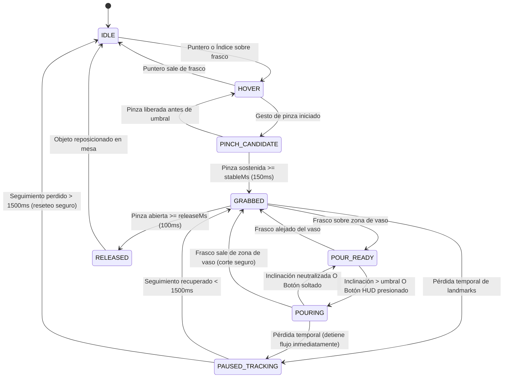

# Arquitectura del Sistema — SymbioLab 2.0

- **Versión de arquitectura**: 0.2.0 (Basada en SDD consolidado y protocolos de Mente Compartida)
- **Fecha**: 30 de octubre de 2026
- **Stack principal**: Svelte 5 + TypeScript + Three.js (WebGL 2) + MediaPipe Vision (Local WASM) + IndexedDB + Vite PWA
- **Estado**: Aprobado para diseño e implementación (Feature 001)

---

## 1. Componentes del Sistema

| Componente | Módulos Clave | Responsabilidad y Contrato Técnico | Evidencia / Pruebas Asociadas |
| :--- | :--- | :--- | :--- |
| **Adaptador de Captura** | `src/lib/input/camera/capture_adapter.ts` | Gestión estricta del ciclo de vida de `getUserMedia`, resolución adaptativa y apagado inmediato de streams (`track.stop()`). Nunca almacena fotogramas crudos. | `tests/input/test_camera_lifecycle.ts` |
| **Interprete de Visión Local** | `src/lib/input/hand/mediapipe_loader.ts`, `hand_landmarker.ts` | Carga de binarios WASM y modelo `hand_landmarker.task` exclusivamente desde rutas locales (`/static/models/mediapipe/`). Extracción efímera de 21 landmarks de una mano. | `tests/input/test_mediapipe_offline.ts` |
| **Reconocedor de Gestos y Filtro** | `src/lib/input/gestures/pinch_detector.ts`, `tilt_estimator.ts` | Normalización de landmarks a escala de palma; detección de pinza con histéresis temporal (`stableMs`, `releaseMs`); pausa segura ante pérdida de seguimiento. | `tests/input/test_pinch_hysteresis.ts` |
| **Adaptador de Controles Accesibles** | `src/lib/input/traditional/mouse_keyboard_adapter.ts` | Emulación completa de las acciones del laboratorio mediante clic/arrastre, teclado accesible y controles táctiles directos, garantizando paridad funcional. | `tests/input/test_fallback_parity.ts` |
| **Bus de Intenciones (InputIntentBus)** | `src/lib/input/intent/intent_bus.ts`, `intent_types.ts` | Desacopla la fuente de entrada de la simulación. Normaliza cualquier interacción a eventos de dominio (`SELECT`, `GRAB`, `MOVE`, `POUR`, `RELEASE`, `CANCEL`). | `tests/input/test_intent_bus.ts` |
| **Escena y Cámara 3D (View3D)** | `src/lib/lab3d/scene.ts`, `table_station.ts`, `raycaster.ts` | Renderizado WebGL 2 con Three.js desde perspectiva subjetiva (primera persona). Modelado low-poly optimizado de mesa, vaso y frascos reactivos. | `tests/lab3d/test_raycast_targets.ts` |
| **FSM de Interacción de Objetos** | `src/lib/interaction/object_fsm.ts`, `pour_controller.ts` | Control de estados (`IDLE`, `HOVER`, `GRABBED`, `POUR_READY`, `POURING`). Valida colisiones de área de vertido y regula la tasa de flujo volumétrico. | `tests/interaction/test_object_fsm.ts` |
| **Motor Científico Determinado** | `src/lib/science/chemistry/acid_base_solver.ts`, `invariants.ts` | Función pura en TypeScript sin dependencias externas. Modelo `strong-acid-base-25C-v1` con solución cuadrática estabilizada y rechazo estricto de NaN/negativos. | `tests/science/test_acid_base_solver.ts` |
| **Visualizador de Indicador Virtual** | `src/lib/science/chemistry/universal_indicator.ts` | Mapeo determinista de pH a bandas categóricas de color pedagógico con advertencias explícitas de modelo didáctico idealizado. | `tests/science/test_indicator_bands.ts` |
| **Motor Pedagógico y Tutor Socrático** | `src/lib/education/socratic_tutor.ts`, `scientific_method_fsm.ts` | Tutor por reglas basado en categorías de diagnóstico (`acid_excess`, `near_equivalence`, `base_excess`, `invalid_input`). No usa LLM en P0 para evitar alucinaciones. | `tests/education/test_socratic_rules.ts` |
| **Cuaderno y Persistencia Local** | `src/lib/storage/notebook_repository.ts`, `exporter.ts` | Almacenamiento local en IndexedDB del historial de ensayos (`trials`), hipótesis y reflexiones; exportador a JSON estructurado y CSV con unidades físicas. | `tests/storage/test_notebook_indexeddb.ts` |
| **Gestor Offline PWA** | `src/service-worker.ts`, `src/lib/offline/readiness_verifier.ts` | Precache de modelos WASM, texturas, shaders y bundles. Verificación de integridad con manifiesto offline para garantizar operación en modo avión. | `tests/offline/test_pwa_readiness.ts` |

---

## 2. Diagrama de Flujo Arquitectónico

```mermaid
flowchart TD
    subgraph Inputs["1. Capa de Entradas (Aislamiento de Dispositivo)"]
        CAM["Cámara Web (getUserMedia)"] --> MP["MediaPipe Local (WASM + Model)"]
        MP --> GEST["Reconocedor Gestual (Pinza + Inclinación)"]
        TRAD["Mouse / Teclado / Pantalla Táctil"] --> NORM_TRAD["Normalizador Accesible"]
    end

    subgraph Bus["2. Desacoplamiento de Intención"]
        GEST -->|GestureEvent| INTENT["InputIntentBus (select/grab/move/pour/release)"]
        NORM_TRAD -->|TraditionalEvent| INTENT
    end

    subgraph World3D["3. Espacio Virtual 3D y FSM (Three.js WebGL2)"]
        INTENT --> FSM["Interaction FSM (Raycast + Zonas)"]
        FSM --> SCENE["Escena 3D Subjetiva (Mesa, Vaso, Frascos)"]
        SCENE --> HUD["HUD de Unidades y Parámetros"]
    end

    subgraph Domain["4. Dominio Científico Determinista"]
        FSM -->|Evento Validado (appliedMl)| SOLVER["ScienceEngine: strong-acid-base-25C-v1"]
        SOLVER --> RESULT["ChemistryResult (pH, [H+], exceso mol/L, warnings)"]
        RESULT --> INDICATOR["Indicador Universal Virtual (Bandas Categóricas)"]
        RESULT --> GRAPH["Gráfica pH vs Volumen + Tabla"]
        INDICATOR --> HUD
        GRAPH --> HUD
    end

    subgraph Pedagogy["5. Tutoría Socrática y Cuaderno"]
        RESULT --> TUTOR["TutorEngine (Preguntas por Clase Diagnóstica)"]
        TUTOR --> METHOD["Método Científico (Hipótesis -> Ensayo -> Reflexión)"]
        METHOD --> HUD
        FSM --> NOTEBOOK["Cuaderno Local (IndexedDB)"]
        RESULT --> NOTEBOOK
        NOTEBOOK --> EXPORT["Exportador Local (JSON / CSV)"]
    end

    subgraph OfflineCore["6. Garantía Offline y Sandbox"]
        SW["Service Worker + CacheStorage"] -.->|Binarios locales| MP
        SW -.->|Assets locales| SCENE
    end
```

---

## 3. Máquina de Estados de Interacción (FSM)

El ciclo de vida de los instrumentos del laboratorio se rige por la siguiente FSM determinista:



### Invariantes de la FSM:
1. **Conservación de masa/volumen:** `appliedMl = min(requestedMl, remainingMl, beakerFreeCapacityMl)`. Si `appliedMl <= 0`, el estado de la mezcla no muta.
2. **Corte inmediato por pérdida de tracking:** Al perderse la mano durante `POURING`, el vertido se detiene en ese fotograma exacto (`deltaTime = 0`).
3. **Desacoplamiento visual:** El renderizador Three.js no calcula moles ni pH; únicamente refleja la posición del frasco y el nivel del líquido informado por el dominio.

---

## 4. Fronteras de Seguridad, Aislamiento y Privacidad

Siguiendo el protocolo estricto de Mente Compartida y la Constitución de SymbioLab:

1. **Cero Persistencia Biométrica (*Zero-Biometric-Persistence*)**:
   - Los fotogramas capturados por `getUserMedia` residen en un elemento `<video>` efímero en memoria volátil.
   - Ningún fotograma crudo, recorte ni array de landmarks se envía a la red ni se escribe en almacenamiento persistente (`IndexedDB`, `localStorage`, `CacheStorage`).
   - Al desactivar el modo gestual o cerrar la pestaña, se ejecutan `stream.getTracks().forEach(t => t.stop())`.

2. **Aislamiento Offline Verificable (*Offline-First*)**:
   - Prohibidas las dependencias en tiempo de ejecución hacia CDNs externos (ej. `cdn.jsdelivr.net` para MediaPipe).
   - Los binarios WASM (`vision_wasm_internal.js`, `vision_wasm_internal.wasm`) y el modelo `hand_landmarker.task` (~8.5 MB) se alojan en `/static/models/mediapipe/`.
   - Política de Seguridad de Contenido (CSP) estricta:
     ```http
     Content-Security-Policy: default-src 'self'; script-src 'self' 'wasm-unsafe-eval'; style-src 'self' 'unsafe-inline'; img-src 'self' data: blob:; connect-src 'self'; worker-src 'self' blob:;
     ```

3. **Sin Backend ni Telemetría**:
   - En la Feature 001 (P0) no existe servidor de aplicaciones, bases de datos remotas ni analítica de terceros. Todo el cómputo y almacenamiento se ejecuta localmente en el navegador del cliente.

---

## 5. Motor Científico Determinado (`ScienceEngine`)

El motor implementa el modelo pedagógico **`strong-acid-base-25C-v1`** para mezclas ideales de ácido fuerte monoprótico (ej. $\text{HCl}$) y base fuerte monovalente (ej. $\text{NaOH}$).

### Formulación Matemática Estabilizada:
Sea $V_a$ y $V_b$ los volúmenes vertidos en Litros ($mL \times 10^{-3}$), $C_a$ y $C_b$ las concentraciones molares ($\text{mol/L}$), y $V_{total} = V_a + V_b + V_{agua}$:

$$d = \frac{C_a V_a - C_b V_b}{V_{total}}$$

Donde $d$ es la concentración molar de exceso ácido firmada. Para el equilibrio de autoprotólisis del agua a 25 °C ($K_w = 1.0 \times 10^{-14}$):

$$[H^+]^2 - d[H^+] - K_w = 0$$

Para evitar **cancelación catastrófica** de coma flotante IEEE 754 cuando $d < 0$ (exceso de base):

$$[H^+] = 
\begin{cases} 
\dfrac{d + \sqrt{d^2 + 4K_w}}{2} & \text{si } d \ge 0 \\
\dfrac{2K_w}{\sqrt{d^2 + 4K_w} - d} & \text{si } d < 0 
\end{cases}$$

$$pH = -\log_{10}([H^+])$$

### Fixtures Unitarios de Certificación:
- **Agua pura virtual** ($V_a=0, V_b=0, V_{agua}=100\text{ mL}$): $pH = 7.000 \pm 0.001$.
- **Ácido puro 0.01 M** ($V_a=50\text{ mL}, C_a=0.01\text{ M}, V_b=0$): $pH = 2.000 \pm 0.005$.
- **Base pura 0.01 M** ($V_b=50\text{ mL}, C_b=0.01\text{ M}, V_a=0$): $pH = 12.000 \pm 0.005$.
- **Neutralización equimolar** ($50\text{ mL de } 0.01\text{ M } \text{HCl} + 50\text{ mL de } 0.01\text{ M } \text{NaOH}$): $pH = 7.000 \pm 0.001$.

---

## 6. Estructura de Directorios del Código Fuente

```text
Takumi-Soft/
├── .agents/                      # Configuración de agentes y MCP local
│   └── mcp_config.json
├── docs/                         # Documentación de arquitectura y decisiones
│   └── architecture.md
├── static/                       # Recursos estáticos servidos localmente (Zero-CDN)
│   ├── assets/models/3d/         # Modelos glTF de frascos, vaso y laboratorio
│   └── models/mediapipe/         # Binarios WASM y hand_landmarker.task
│       ├── vision_wasm_internal.js
│       ├── vision_wasm_internal.wasm
│       └── hand_landmarker.task
├── src/
│   ├── lib/
│   │   ├── core/contracts/       # Tipos TypeScript y esquemas JSON versionados
│   │   │   ├── interaction.ts
│   │   │   ├── chemistry.ts
│   │   │   └── session.ts
│   │   ├── input/                # Ingesta, visión y bus de intención
│   │   │   ├── camera/           # getUserMedia y ciclo de vida de dispositivos
│   │   │   ├── hand/             # MediaPipe Hand Landmarker local
│   │   │   ├── gestures/         # Detector de pinza, histéresis y filtrado
│   │   │   ├── traditional/      # Adaptador mouse/teclado/táctil
│   │   │   └── intent/           # InputIntentBus normalizado
│   │   ├── lab3d/                # Three.js (WebGL 2)
│   │   │   ├── scene.ts          # Configuración de escena y render loop
│   │   │   ├── station.ts        # Mesa de trabajo y entorno de laboratorio
│   │   │   └── objects.ts        # Vaso graduado, frascos reactivos
│   │   ├── interaction/          # FSM de interacción física y vertido
│   │   │   ├── object_fsm.ts     # Máquina de estados finita
│   │   │   └── pour_engine.ts    # Control de tasas de vertido y volumen
│   │   ├── science/              # Motor científico determinista
│   │   │   └── chemistry/        # Solver analítico ácido-base y bandas de indicador
│   │   │       ├── acid_base_solver.ts
│   │   │       ├── universal_indicator.ts
│   │   │       └── fixtures.ts
│   │   ├── education/            # Tutor socrático y método científico
│   │   │   ├── socratic_tutor.ts # Reglas y preguntas diagnósticas
│   │   │   └── scientific_method.ts
│   │   ├── storage/              # Persistencia local IndexedDB y exportador
│   │   │   ├── indexeddb_repo.ts
│   │   │   └── csv_json_exporter.ts
│   │   └── offline/              # Comprobación de estado PWA y recursos
│   │       └── readiness.ts
│   ├── routes/                   # Vistas principales de la aplicación Svelte 5
│   │   ├── +layout.svelte        # Layout base con HUD superior y estado offline
│   │   └── +page.svelte          # Laboratorio interactivo 3D
│   ├── service-worker.ts         # Precache offline integral
│   └── app.html
├── tests/                        # Suite de pruebas unitarias y de integración
│   ├── science/                  # Pruebas del solver químico y estabilidad
│   ├── input/                    # Pruebas de histéresis y bus de intención
│   ├── interaction/              # Pruebas de la FSM y límites de vertido
│   └── storage/                  # Pruebas de IndexedDB y exportación
├── package.json
├── svelte.config.js
├── vite.config.ts
└── tsconfig.json
```

---

## 7. Contratos de Datos Principales

### 7.1 Intención Normalizada (`InteractionIntent`)
```typescript
export type IntentKind = 'select' | 'grab' | 'move' | 'pour' | 'release' | 'cancel';

export interface InteractionIntent {
  intentId: string;
  kind: IntentKind;
  objectId?: string;
  source: 'gesture' | 'mouse' | 'touch' | 'keyboard';
  deltaX?: number;
  deltaY?: number;
  pourRate?: number;       // 0.0 a 1.0
  timestampMs: number;
}
```

### 7.2 Entrada Química (`ChemistryInput`)
```typescript
export interface ChemistryInput {
  acidVolumeMl: number;       // mL >= 0
  acidConcentrationM: number;  // mol/L > 0
  baseVolumeMl: number;       // mL >= 0
  baseConcentrationM: number;  // mol/L > 0
  waterVolumeMl: number;      // mL >= 0
  temperatureC: 25;           // Constante en P0
}
```

### 7.3 Resultado Verificable (`ChemistryResult`)
```typescript
export type DiagnosticClass = 'acid_excess' | 'near_equivalence' | 'base_excess' | 'invalid_input';

export interface ChemistryResult {
  modelId: 'strong-acid-base-25C-v1';
  modelVersion: '1.0.0';
  pH: number;
  hydroniumConcentrationMolPerL: number;
  excessConcentrationMolPerL: number;
  diagnosticClass: DiagnosticClass;
  indicatorBand: {
    category: 'acidic' | 'neutral' | 'basic';
    representativeHexColor: string;
    description: string;
  };
  assumptions: string[];
  warnings: string[];
  computedAt: string;
}
```
